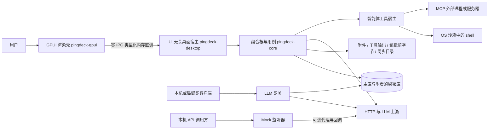
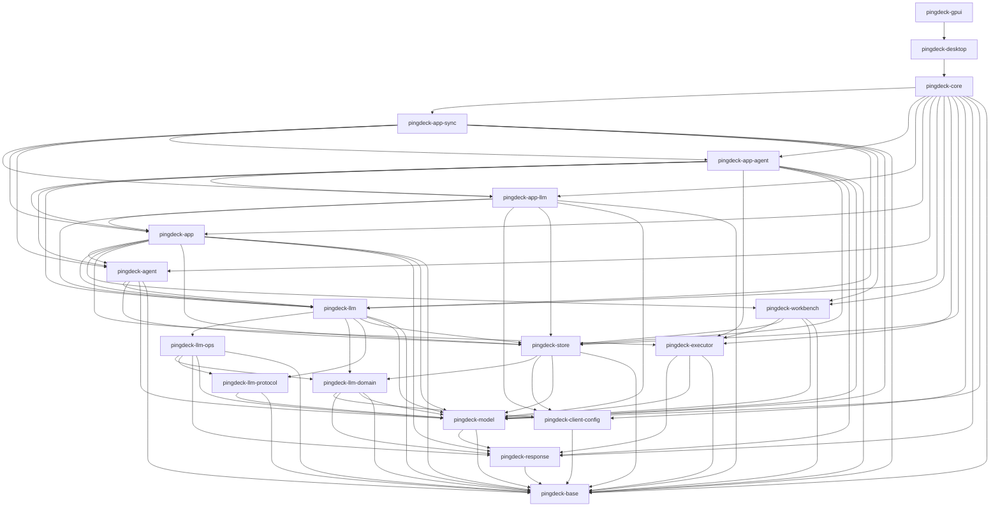
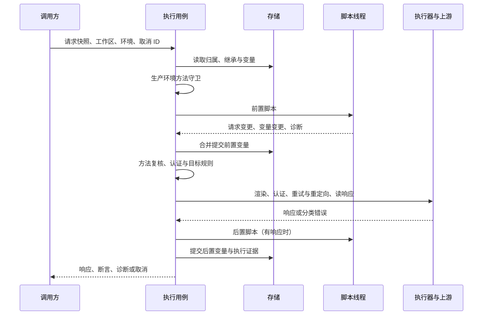

# 系统架构

维护者读完要能回答四件事：一次操作跨过哪些边界，谁持有任务和数据，失败时保证到哪一步，改某一层要守住哪些约束。用户看得到的行为见[产品手册](product.md)，用户可见的限制数值只写在 [PRD](product/PRD.md)，取舍理由见[决策记录](decisions.md)。

## 1. 系统上下文与信任边界

PingDeck 是一个纯 Rust 原生桌面进程：GPUI GPU 渲染壳（`pingdeck-gpui`）、UI 无关桌面宿主与无头状态层（`pingdeck-desktop`）以及可脱离界面使用的 Rust 业务核心（`pingdeck-core` 及其下 17 个 crate）。核心另外运行本地监听器（Mock、LLM 网关）、出站调用和子进程，它们各有安全政策，也不共用一个异步运行时。

- 界面输入、导入内容、网络响应、模型输出和 MCP 结果都不算授权。核心重新校验对象归属、目标、权限与文件路径。
- 进程内零 IPC 直调不绕过核心边界：路径授权、权限审批与敏感操作确认照样在核心强制执行。
- 工作区隔离防止对象误归属，挡不住同一 OS 用户下的恶意进程。应用数据、shell 与 MCP 进程都以该用户的权限运行。
- 网络政策分四类：用户发起的 API 调试、本地网关入站、模型驱动的网页抓取、服务商调用。§10 逐个入口列出。

## 2. crate 依赖 DAG 与职责

箭头是“调用方 → 直接依赖”，取自各 crate 的 path 依赖。这是有分支的 DAG，没有一条线性分层。

| crate | 职责 |
| --- | --- |
| `pingdeck-base` | 错误与秘密契约、取消、平台路径、SSRF 守卫、代理选路、URL 编码、脱敏、诊断日志；不知道工作区 |
| `pingdeck-response` | 大正文缓存、响应正文视图与唯一的 JSONPath 方言；只依赖 base |
| `pingdeck-model` | 共享实体、设置模型与校验、协议与事件词汇；没有 I/O |
| `pingdeck-llm-protocol` | 各协议与 hub 互转的编解码、有界 SSE 解析；无网络与文件 I/O |
| `pingdeck-client-config` | AI 编码工具配置的预览、写入、检查、还原与换令牌；只做文件 I/O，不碰数据库 |
| `pingdeck-llm-domain` | LLM 记录类型、服务商校验、预设、探针规划、健康与状态规则、用量计价、目录分组，以及余额、抓包、扫描摘要的存储形状；无 SQLite |
| `pingdeck-llm-ops` | 嗅探、余额适配器、抓包脱敏与计时、SSRF 守卫传输与 CA 包 |
| `pingdeck-store` | 唯一的 SQLite 仓储层：schema、连接池、秘密库、按内容寻址的附件；LLM 记录类型取自 llm-domain |
| `pingdeck-executor` | HTTP 渲染、认证、重试与重定向、脚本与断言、OAuth |
| `pingdeck-workbench` | 导入导出、Mock 与 Flow 引擎 |
| `pingdeck-llm` | 路由与故障转移、探测执行、本地网关，并转出 llm-protocol 的协议编解码与 llm-domain 的记录和规则 |
| `pingdeck-agent` | 运行循环、权限、沙箱、MCP、技能与工具契约、外部文本的提示围栏，以及聊天附件桥接与窗口路径授权；不依赖组合根与 UI |
| `pingdeck-app` | 组合根，以及请求、工作区、Flow、Mock、设置与系统用例和请求代码片段生成 |
| `pingdeck-app-llm` | 服务商、网关、模型目录、余额与用量用例 |
| `pingdeck-app-agent` | 对话、智能体运行、MCP 与技能用例 |
| `pingdeck-app-sync` | 文件夹同步与秘密清理用例 |
| `pingdeck-core` | 桌面运行时装配、门面、跨 crate 集成测试 |
| `pingdeck-desktop` | UI 无关桌面宿主：运行时、单实例锁、合帧、OS 服务、主题、i18n 与状态机 |
| `pingdeck-gpui` | 薄 GPUI 渲染壳：仅 `ui` 适配组件库，`views` 渲染 9 模块，产出 `pingdeck` |

SQLite 只在 `pingdeck-store`：只有它直接依赖 SQLite 驱动，DDL 与全部 SQL 读写都在它里面，别的 crate 只调它的仓储函数。

连接池在克隆的句柄之间共享，空闲连接有上限，借出数不设限。新连接开启外键与 WAL，并附着秘密库；归还时丢弃未提交的事务。日志写线程、批量读写、路由快照和文件库上的秘密存储各借自己的池连接，所以拿住组合根的共享连接锁，并不排除别的写者；持锁时调用秘密存储也不会自锁（内存库没有文件可借池连接，仍共用那把锁）。

## 3. 组合根、桌面适配与 headless

组合根在 `pingdeck-app`：一个可克隆的状态句柄，装配仓储、秘密存储、设置快照、LLM 与智能体与同步的运行时、Mock 管理器、历史写线程、取消注册表和大正文缓存。后台任务持有克隆的句柄，可以活过发起它的 IPC 调用。

`src-tauri` 的命令层只做转发：把 IPC 参数变成核心输入，把事件出口映射成 Channel，原样返回核心的错误。对话框、文件 I/O 等阻塞操作走专用的阻塞线程，不占异步运行时。原生选择器产生路径授权，Webview 不能按任意路径读文件。

启动分两段。第一段先对数据目录里的 `pingdeck.lock` 取独占的建议锁（标准库的文件锁，进程结束时由系统释放，崩溃也不会留下死锁），再打开日志与存储并装配状态，建目录，标记上次未完成的运行，清理孤立凭据，结算文件编辑日志。

锁被另一个进程持有时只弹“PingDeck 已在运行”并以 0 退出，不碰存储，所以崩溃恢复和第二段的遗留进程收割只会在拥有该目录的进程里执行，第二个进程不会把第一个进程活着的运行、完全权限、文件日志和子进程当成崩溃遗留处理掉。数据库打不开就显示原生错误并退出，不留一个所有命令都失效的窗口。

第二段在窗口可见之后：收割遗留进程，清理附件与过期的工具输出，预热沙箱与 PATH，启动 LLM 例程。第二段的失败只记警告，网关自启失败留在网关状态里，普通请求照常工作；每条提示（停掉的遗留进程、失败的清理、没起来的网关）都写进诊断日志，并留在核心里供页面读取。

页面加载可能早于或晚于这段例程，所以它启动时读一次，同时监听桌面层在例程结束时发出的事件，有提示就弹一次可复制的 toast。第二段与退出流程跨越几个用例 crate，编排放在 `pingdeck-core`。

内存库适合用例测试；网关、附件和文件编辑日志需要数据目录。headless 调用方要自己提供数据库、异步运行时、事件出口和生命周期管理，产品没有对外的 CLI。平台前置工作留在启动最早处：Linux 的 Wayland 与 NVIDIA 规避在 GTK 初始化前设置环境，尊重用户的显式覆盖。平台路径归一化收在 `pingdeck-base`。

## 4. 界面边界与状态

### 4.1 四层边界与模块隔离

`crates/pingdeck-desktop` 承载 UI 无关宿主（运行时、合帧、OS、OKLCH 主题、i18n、状态机与 `state/process_graph` 排版引擎）。`crates/pingdeck-gpui/src/ui` 是全仓唯一引入 `gpui_kit::component` 的边界，含共用画布 `dag_canvas` 与 `process_chrome`。

`crates/pingdeck-gpui/src/views/shell` 注册 10 大目的地与实用工具，按需实例化并保活。智能体工作流（`views/runs`）与流程（`views/flows`）共用排版与画布，数据与持久化隔离。层间依赖与文件行数（≤ 600 行）由 `cargo xtask check-arch` 强制检查。

### 4.2 运行与视图分离

模块首次访问才挂载，之后隐藏保留实体与订阅，不停止后台核心任务。高频流事件通过 `pingdeck-desktop` 的 `CoalescingSink` 与 `subscribe_stream_into` 批处理合帧提交；大响应与万行表格由原生 Rope 编辑器与虚拟 `DataTable` 直接渲染可见区域，流式 Markdown 增量渲染且支持划选复制。

### 4.3 本机状态与持久业务状态

界面偏好（`ui_state.json`）与对话输入草稿（`chat_drafts.json`）由 `pingdeck-desktop` 以 `0600` 权限原子写入数据目录，请求标签会话由核心按工作区存库，三者的所有者、保留与同步规则各不相同。标签会话里的草稿把代理口令存成掩码：没保存的新口令不跨会话保留，恢复时核心从代理地址里去掉口令并标记 `proxy_password_lost`，界面提示重新输入，发送不会用请求旧存的口令，也不会把掩码当口令发出。

刷新按“最新请求胜出”。失败可以保留上次的数据，但要显示错误，旧数据不能显示成新操作的成功。临时响应句柄和事件序号只在本次进程有效，不作长期身份。

### 4.4 文案与 i18n

文案按区域归属：仓库根 `locales/` 下 14 个区域各有一对 `en.json` 与 `zh-CN.json`，由 `pingdeck-desktop` 的 `build.rs` 在编译期生成强类型零分配访问器 `Tr` 与有序动态查找表；GPUI 渲染层通过 `crate::ui::tr(cx)` 消费全局语言状态。`cargo xtask check-i18n` 检查双语键一致、占位符与复数对一致、中英文间距、禁用文案守卫，以及零死键与源码禁止硬编码双语/中文守卫。排版规则见[设计文档](design.md)。

### 4.5 零 IPC 直调与类型共享

- 界面层与核心同进程运行，直接调用 `pingdeck_desktop::core::app::*_impl` 并消费强类型 Rust 结构体，无需 JSON 序列化桥或跨语言绑定生成。
- 阻塞 SQLite 与文件操作经 `crates/pingdeck-gpui/src/bridge` 派发到 Tokio 阻塞线程池，结果回到 GPUI 主线程更新视图实体。

## 5. 数据、一致性与恢复

### 5.1 存储布局

| 位置 | 内容 | 约束 |
| --- | --- | --- |
| 主 SQLite（WAL） | 工作区对象、设置、历史、LLM 与智能体元数据 | 多连接并发；保留策略只管空间，不作审计 |
| 主库旁的 `.secrets` 库 | 凭据值，作为附着库打开 | 明文 SQLite，Unix 权限 0600；访问秘密的连接都要附着 |
| 数据目录文件 | 附件、编辑前字节、工具输出全文、客户端配置原件、托管技能 | 在数据库事务之外 |
| 外部文件 | 用户项目、客户端配置、同步目录 | 可能被并发修改，写前复核哈希或指纹 |
| 进程内存 | 审批、监听器、缓存、回放与撤销保留区 | 页面可重连；应用重启后原执行不恢复 |
| 数据目录的 `pingdeck.lock` 与 `logs/` | 单实例锁；轮转的诊断日志（每条先脱敏） | 锁文件内容为空，只靠系统文件锁；日志 0600，5 MiB 轮转，保留 3 个文件 |

组合根的共享连接锁只串行化那一条连接，锁不跨 `.await` 持有，异步用例把同步工作放进阻塞线程。文件库上的秘密存储借自己的池连接、不取这把锁，持锁时调用它不会自锁；只有内存库（测试）的秘密存储共用这把锁，持锁时再调会自锁。

### 5.2 事务覆盖到哪里

- 聚合保存、历史插入及该类历史的修剪、Flow 与集合运行摘要及修剪、设置的批量保存，各自一个事务。
- 存储层的写事务一律在开始时就取写锁（`BEGIN IMMEDIATE`），别的连接的写入在开始时排队，避免读后升级撞上已变化的快照。在已开启的事务里再调用写入，会变成该事务内的 savepoint：失败只回滚自己那一段，提交随外层事务。
- 前置与后置脚本分阶段提交变量，同键并发修改报 Conflict。没有一个长事务包住脚本、网络、历史和 Cookie。
- 一次发送先写历史，再另写 Cookie。历史没写成时实时响应照常返回，并标明这次没有留下记录。响应带回 `cookie_report`：保留的 Cookie 是否写进了 Cookie 罐（已存、未存、失败），以及每条没保留的 Set-Cookie 和原因（格式错误、Domain 不覆盖来源主机、公共后缀、超过 4096 字节）。
- Cookie 的过期时间在收到时定下：`Max-Age` 换算成绝对的 `Expires` 存进同一列，之后编辑不会续命；`Expires` 还接受 `21-Oct-2025` 这类连字符写法和两位年份，解析不了的属性按 RFC 6265 忽略。`Domain` 是公共后缀（`localhost`、单标签主机）且等于请求主机时存为仅限主机。直连的回环主机（`localhost`、`127.0.0.0/8`、`::1`）算安全上下文，Secure Cookie 会经 http 发给它；走代理或 `*.localhost`（解析器不钉回环）不算。
- 发送视图里的 Cookie 头只显示名字，值打码。
- 设置写入先校验、再持久化、最后发布内存快照。秘密值另有写入步骤，快照没发布时已写的秘密值仍可能留下。
- 主库与附着库在 WAL 下没有跨文件的崩溃原子性，附件与项目文件编辑更在事务之外。
- 取消不回滚已提交的变量和远端副作用。所以用例的返回值要分开“外部操作的结果”和“持久化的证据”。

### 5.3 单一基线 schema 与秘密库

存储只有一个基线 schema，没有迁移。新库在一个事务里建出完整 schema，并把基线 DDL（含秘密库的列定义）的指纹写进 `user_version`。打开库时指纹相同才继续，不同的非空库不打开。指纹忽略注释与排版，但改动基线 DDL 的任何定义都会改变它，所以开发期改 schema 后旧库会被移到一旁。

移到一旁的做法：启动时把主库、同名 `.secrets`、各自的 `-wal`、`-shm`、`-journal` 和同目录的 `attachments` 一起改名为 `<名称>.bak-<UTC 时间>`，重名加序号。附件随旧库移走，否则启动时的附件回收在新库里找不到引用，会删掉它们。全部改名成功才新建空库，失败就把已改名的文件改回并报错；随后弹窗列出每个备份。

主库连接设 `secure_delete = FAST`：被删除的行在 SQLite 本来就要重写的页里清零，不额外增加 I/O；挪进空闲页链表的页要等复用或压缩才覆盖。秘密库设 `secure_delete = ON`。

「设置 › 数据与同步」的“压缩”持 store 锁，在共享连接上对主库和秘密库执行 `VACUUM` 并截断 WAL。共享连接上的读写在锁上排队到完成；池连接上的后台写者（网关日志、用量、秘密）只等 5 秒忙超时，库很大时可能在压缩期间失败。“备份数据库”在池连接上用 `VACUUM INTO` 分别写出主库与 `<文件>.secrets` 的一致副本，先写同目录的 0600 临时文件，完整后再改名覆盖。备份目标不能在数据目录内，免得改名覆盖正在使用的库、秘密库、WAL 或实例锁。

请求的响应示例不占列：它们和网络选项存在同一个 JSON 对象（`requests.network_options_json` 的 `examples` 键）里，读写时由存储层拆开，编辑器保存不带示例时沿用已存的。历史里的请求快照不含示例。

秘密表只建在附着的秘密库里，主库从不建同名表；主库里若已有会遮蔽它的表，同样拒绝打开。内存库没有秘密库，才把秘密表建在主库。秘密值以明文存放，文件权限只挡别的 OS 用户，管不到用户自己复制出去的文件。

### 5.4 大正文和附件

大 HTTP 正文在脚本与断言处理之后外置到进程内的大正文缓存，界面拿句柄和预览，阈值由设置决定。格式化与 JSONPath 在核心处理，原始字节走专用 IPC，不反复做 JSON 序列化。缓存只按总字节（64 MiB）淘汰最久未用的正文，不限条数；单个超过预算的正文也保留，直到下一个正文进来。句柄被淘汰或进程重启后返回 NotFound，调用方提示重发。

响应 JSON 格式化保留原文的词法：对象顺序与重复键、数字拼写、字符串转义都不改写。XML 与 HTML 格式化保留畸形片段和原始属性拼写，它们只排版、不校验。

附件按内容哈希落盘，元数据与引用在库中。预览经原始字节 IPC 转成 `data:` URL，asset 协议保持关闭。路径导入要有原生选择或拖放授权，并校验大小与类型。PDF 文字提取用自带的有界扫描，单流与跨流总解压量都有上限，现成的库只给单流上限。

## 6. HTTP 执行链

已保存请求的 Send、草稿、集合运行、Flow 与智能体的 `send_request` 共用 `pingdeck-app` 里的一条执行管线和 `pingdeck-executor` 的传输。AI 服务商目标走另一条管线；集合运行与 Flow 遇到 AI 请求时分派过去，步骤判定仍只看请求断言。AI 服务商目标在脚本之后锁定 URL、主机与凭据，脚本看不到注入的密钥。

变量优先级为 globals → collection → environment → data → local，每个名字由最窄一层里启用的那一行决定。值为空的机密（清空了，或同步、导入时没带值）同样算定义：它遮住下层的同名值，本身不解析，发送报未解析，不会把下层的同名令牌发出去。未解析扫描、已解析视图和对比都用这条规则（`EnvironmentVariable::needs_value`）。

未解析的变量在主请求传输前失败，错误列出全部未解析的名字。脚本可以自己发附加请求，所以“主请求发出前已校验”管不到脚本的请求。生产环境守卫保护环境要求确认的方法，并复核脚本扩大后的方法；脚本的附加请求受同一守卫，未确认的受保护方法被拒。

执行器控制超时、正文上限、跨源时剥离凭据和有限的重试。超时分两种：`timeout_ms` 是空闲超时，限住建连、等响应头和正文相邻两块之间的间隔，持续发数据的流（SSE、NDJSON、长轮询）不会被它切断；`total_timeout_ms` 是可选的总时限，覆盖所有重定向跳和正文；集合运行与 Flow 步骤的请求没设时由执行管线补上 5 分钟。响应头到达之后，空闲超时、总时限，以及界面单次发送里的停止，都只结束读体：状态码、响应头和已收到的字节保留下来，结果用 `body_incomplete` 标明原因；响应头之前触发的仍是超时失败或取消。流式响应不逐条推送到界面，读体结束后整体返回。

正文上限只限住捕获的字节。普通发送读到上限就停，结果标为截断；响应声明了未压缩的 `Content-Length` 时，结果另给真实大小，界面把已捕获大小和真实大小分开显示。“发送并保存到文件”先由壳层打开原生保存框选定路径（路径不来自 Webview），再把整段正文边收边写进文件、不设上限，捕获部分照常交给脚本、断言和查看器。

取消 ID 在命令真正运行后才登记，派发前取消与登记竞态由前端处理。传输、读体、OAuth 和退避都检查取消；脚本线程不能强行终止，只能停止等待并丢弃迟到的输出。

失败语义：前置脚本错误阻止主发送；后置脚本错误附在已有响应上；断言失败与传输失败分开计。网络错误带原因分类（超时、TLS、DNS、拒绝、重置、代理鉴权与不可达）。响应头之前的取消不新增该次历史；界面单次发送在响应头之后停止时保留部分响应、跳过后置脚本并照常写历史。已提交的变量和远端副作用都不回滚。

断言在执行管线里一次求值。除固定种类外，`Check` 是“目标 + 运算符 + 期望值”的形式：目标是状态码、响应头、JSON 路径、正文、耗时或正文大小，运算符覆盖相等与取反、存在与不存在、包含、大小比较、正则（与 AI 断言同一正则方言）和 JSON 类型。正文大小类断言在真实大小已知时读真实大小，否则读捕获大小。

`JsonSchemaValid` 用离线的 JSON Schema 校验整段正文或某个 JSON 路径上的值，接受 OpenAPI 的注解关键字与 `x-` 扩展，其他未知关键字照样报错。脚本里的 `pm.response.to.have.jsonSchema` 与 `tv4.validate` 用同一个校验器。每条历史记录写明来源（流程运行、集合运行、智能体运行、Mock 命中或模型调用），模块之间据此跳到对方的只读记录；来源为空按未知处理。

脚本的断言对象经 `Proxy` 严格查找：未知断言词抛错，不会读成 `undefined` 后误判通过。深比较按 chai deep-eql 的结构规则。

脚本经桥接新建环境、集合或全局变量时，名称属于凭据名或值带令牌形状就建成机密。凭据名与脱敏共用头名和查询键规则。

`pm.cookies.jar()` 只接受请求主机本身、父域或子域的 URL。写入经脚本输出交回管线；记录型发送且请求使用 Cookie 罐时，与响应 Cookie 一样存库。

## 7. Flow 与 Mock：共用执行管线，各管生命周期

Flow 引擎依次评估条件、等待、覆盖、尝试、抽取和断言；运行前校验范围内步骤并执行环路检测（`check_flow_dag_cycles`），有错即拒。

含显式依赖、条件节点或汇合节点的完整运行走 `flows/dag.rs` 并行波次调度（并发上限 `MAX_FLOW_CONCURRENCY = 8`）：同波次并发执行，完成后按 `position` 合并变量；未命中条件分支自动传播跳过，汇合节点等待活跃上游完成。拓扑与固定坐标存于现有 `steps_json` / `options_json`，不改 SQLite schema 基线。

条件是有界的小表达式，长度、记号数与嵌套深度都有上限。先解析再填变量，变量值不改变解析结果。保存时校验语法，错误带步骤 ID 与字段名；条件为假的步骤不等待，直接跳过；运行时无法求值则该步失败。

Flow 变量是每步上下文里最窄的局部作用域：抽取值和脚本经 `pm.variables` 写的值只在本次运行里传播；集合运行的局部变量在一次迭代内跨请求保留。机密提取项（凭据名默认是）的值标为机密，后续步骤的发送记录里打码，同名的起步变量也按机密处理。运行摘要记下环境 ID 和结束时的变量，机密值、匹配脱敏规则的值与超长值只记名字。

Flow 用“只写历史”的持久化：每次尝试写一条带运行 ID 的历史，响应 Cookie 进本次运行自己的 Cookie 罐，运行结束即丢弃，工作区的 Cookie 不变。运行摘要连同逐步摘要和取消状态入库；集合运行的摘要也入库，两者各按保留次数修剪。

Mock 管理器拥有独立、惰性创建的 Tokio 运行时与出站客户端。每台服务拥有自己的连接、回调和运行中的数据桶；配置整体替换实现热更新，端口与前缀固定到启动时。停止时取消子任务，等关闭后释放端口；命中历史经写线程另行入库。CRUD 数据是运行中的副本，重启按配置重建。

选响应按 Mockoon 语义。按规则顺序与回落两种模式下，没有规则的响应永不算命中，默认响应的规则按位置参与求值。按规则顺序都不中时返回默认响应，没有默认就返回第一条；回落模式都不中时让给代理或 404。停用规则时每次返回默认响应，顺序与随机模式各按游标与随机数。

Mock 只听回环：`127.0.0.1`，本机有 IPv6 回环时同一端口也绑 `[::1]`；`[::1]` 端口被别的进程占用按端口冲突报错。Host 不是回环名、绑定地址或 `mock.extra_allowed_hosts` 里名称的请求返回 403。带端口的条目只认该端口，不带端口的认绑定端口；额外主机只放宽 Host 校验，不改变监听地址。跨站写也返回 403：非安全方法带非回环的 `Origin`，或带 `Sec-Fetch-Site: cross-site`；拒绝发生在路由计数、CRUD 写入、回调与代理之前。CORS 只回显回环 Origin。

出站只有代理与回调两条路，目标要校验，防自环与转发环，连接、头体与回调并发都有上限。请求体与代理两个方向的正文都按字节保留，模板、规则与日志读它的 UTF-8 解码视图；上游正文超过 1 MiB 时返回 502，不截断转发。录制开启时，转发的完整响应按方法与路径去重存在该服务的内存里，有条数与字节上限，随服务停止丢弃。模板引擎是带输出、循环与嵌套上限的 Handlebars 子集，自实现而不引入模板库，理由见决策记录。

流量在写入时记下结果、选择原因、路由与响应的快照名和对应的历史条目，界面只读这些记录，不按当前配置现算。被拒的 Host 与连接已满也进流量，但不写历史、不计命中。回调在流量行写入后才发出，结果补回该行并推给订阅者。复位状态只清游标、请求计数与命中数，数据桶和流量保留。服务可以绑定一个环境，只把普通变量填进代理与回调，机密不展开。

## 8. LLM 路由与网关

LLM 运行时持有路由快照、健康账本、密钥冷却簿、HTTP 客户端、设置和日志写入器。写配置会让快照版本前进，下次读取借独立的池连接重建；设置更新推送新快照。池锁只覆盖借出与归还，不跨查询或 `.await`。网关停止不销毁进程内的 LLM 客户端，Chat、AI 请求和探测照常可用。界面通过 `pingdeck-desktop` 订阅共享的 LLM 事件流，流断开后各自读快照重同步。

### 网关请求的顺序

一次网关请求依次经过：Host 与 Origin 校验 → 路由（`/health` 直接应答，未知路径 404）→ 客户端令牌 → 客户端限额 → 读体与端点限制 → 按模型与客户端范围规划目标。之后是上游尝试（首个内容事件前可轮换密钥、故障转移）→ 同协议直通或 hub 转码 → 客户端响应或流 → 有界日志队列。任何一步拒绝都不调用上游。

- Host 校验在最前。允许的 Host 是回环名、开启局域网时发现的本机身份和 `ai.gateway.extra_allowed_hosts`。带 `Origin` 的请求一律拒绝，网关不提供 CORS。
- `/health` 不要令牌，但仍过 Host 与 Origin。未知路径在令牌检查前返回 404。
- 默认只听回环。`ai.gateway.require_token` 关闭时只放行真正匿名的调用，提交未知或已吊销的令牌仍是 401。局域网必须有令牌和至少一个活动客户端。额外允许主机非空时一律要求令牌，设置补丁不能同时关令牌又加主机。允许 Host 的隧道会把令牌入口带到公网。
- 客户端模型范围在解析模型名之后检查，名称与 id 两种写法按同一个模型授权。范围也约束网关备用链：范围外的备用目标在规划时跳过，不调用它的上游；`/v1/models` 只列范围内的模型。
- 客户端限额存在客户端记录里（与别名列表同列的 JSON）。令牌过期在每条需要令牌的路由上都是 401，模型列表与 token 计数也不例外。其余限额只对会花钱的路由生效，顺序固定：令牌过期 401 → 每日或每月预算、token 数用完 402 → 一分钟滚动窗口超限 429（带 `Retry-After`）→ 同时请求数超限 429。预算按本地日与自然月读用量汇总，每个客户端最多每 10 秒读一次，日志异步落库，所以有几秒的滞后；只累计与预算同币种的成本，价格未知的调用只计 token。达到 80% 与被拒时，每个客户端每天各推一次通知。
- 网关不认识的裸模型名交给客户端默认模型，只在客户端显式开启时发生（Connect 不会替它打开）。请求体保留原名，只改路由；日志记原请求名与实际目标，响应带 `x-pingdeck-model-mapped`。
- 网关的状态变化（局域网关闭、地址变化、启动失败、令牌被强制、备用链被收窄、客户端达到限额）作为事件推给界面，状态里也留一份。

### 协议与失败的提交点

同协议直通只改模型等必要部分，保留原字节与未知字段；请求的输出上限高于目标模型的上限时只改这个数字，并记转换说明。客户端回传了别的协议产生的签名（`pdk1.` 标记）时，只去掉带标记的推理块或签名，其余字段连同 `cache_control` 一起直通。

跨协议经 hub 消息模型转码，每个字段归为映射、可见丢弃或拒绝，丢弃的字段写进响应头 `x-pingdeck-dropped`；字段表未登记的字段一律拒绝该目标，会话引用类字段（`previous_response_id`、`conversation`、存储的 `prompt`、Gemini 的 `cachedContent`）按名拒绝。从其他协议转到 Messages 目标时，网关在系统提示与工具之后、最后一条消息之后各放一个缓存断点，除非该服务商本会话拒绝过缓存提示。

上游以提到 `cache_control` 的 400 拒绝时，同一目标去掉缓存提示再发一次，不判故障转移、不计健康；本会话之后发给该服务商的调用（应用内调用也一样）都不带缓存提示。

计数类与直通端点：`/v1/messages/count_tokens` 按计划顺序问讲 Messages 的目标，取第一个答出 `input_tokens` 的；没有这样的目标，或都没答出（中转缺这个端点、报错、不可达），就返回本地估算并带 `x-pingdeck-token-estimate`。计数不花钱，不写日志行，失败也不计入密钥健康与冷却。Gemini `:countTokens` 只给估算；Gemini `:embedContent` 与 `:batchEmbedContents` 原样转给 Gemini 目标。

`/v1/completions` 与 `/v1/rerank` 不转码，原样（只改模型）转到目标 OpenAI 风格端点旁的同名路径，不支持流式。上游错误体按客户端的协议重新编码，状态码与消息保留。上游 SSE 由自带的增量解析器读取：单行与单个事件的数据各以 8 MiB 为上限，超限时发出带内的溢出事件，解码器把它当作错误。现成的 SSE crate 没有这种上限，所以不用。

模型名按第一个 `/` 切开：左边是服务商名（不分大小写，未过期的曾用名也认）或 id，右边原样是模型 ID；找不到服务商时，404 错误体列出名字相近的现名。备用链归调用方：网关用自己的备用规则，智能体用 `ai.agent.fallbacks` 里当前角色的链，两者都不递归、有长度上限。能否互为备用在保存时按调用类型判断，请求时再按能力过滤。

每个候选展开成一组密钥。鉴权、余额和限流失败换同一模型的下一把密钥；网络错误、超时、5xx、模型不存在和上下文超限换下一个模型；最后一个候选的瞬时 5xx 原地重试一次。本机网络故障（DNS、网络不可达、代理隧道失败）不进熔断。

首个内容事件是提交点。之前可以重试、换密钥、换目标；之后只留在当前目标，出错就以当前协议的错误结束。流没有终止标记就结束算截断：提交前触发故障转移，提交后在已转发的字节之后追加客户端协议的错误帧，同协议直通也一样。所有候选都失败且最后是 429 或 503 时，响应带 `Retry-After`：取上游给的值，没有就取计划内密钥最早结束休息的时间。应用内客户端在提交点报告实际答话的模型，智能体按它的事实塑形请求、按它的价格计费。客户端断开会取消上游，不记成服务商故障。

### 密钥范围、轮换与探测

一个服务商的多把密钥可以属于中转站的不同分组。一把读过模型列表的密钥能调某个模型，满足其一即可：它的列表里有这个模型；服务商没有任何一把密钥列出过这个模型。还没读过列表的密钥只能调当前没有任何密钥列出的模型，别的分组列出的模型要等它自己的列表读到后才归它；新增或换值的密钥保存时核心就排队读它的列表，密钥行在读到前一直标“未读列表”。可用协议是三者的交集：服务商启用的端点、用户给密钥限定的协议、中转站为该模型声明的协议，后两项只在设了时参与。

过滤之后按服务商的轮换方式选起点：固定主密钥、按顺序轮询（每个分组一个游标）或随机，之后绕回，每把最多一次。冷却只在内存：限流只让这把密钥在这个模型上休息，按 Retry-After 或逐次加倍，同一密钥的其他模型照常可用；鉴权、地区与余额失败让整把密钥冷却更久；成功清零。轮询会记住一段对话（系统提示与首条消息的哈希）起步的密钥，同一对话后续请求留在同一把密钥上，让上游的提示缓存可复用。规划跳过冷却中的密钥；一个模型的密钥全在冷却时照样尝试，最早到期的先试，排在有可用密钥的候选之后。测试台、AI 请求与密钥测试显式指定密钥，不参与轮换。密钥明文只交给发起查看的界面，不进日志和错误信息。

密钥列表把整把密钥的冷却显示为冷却中，没有时显示最早结束的模型限流休息；“清除冷却”同时清掉模型休息。

探测只写探测结果。能力矩阵只在用户“应用结果”时更新，所以一次失败的探测不会让模型悄悄从路由里消失。从同步导入的新服务商在用户复核前不作备用目标。删服务商在同一事务里清掉指向它的价格、规则、客户端范围与角色模型，并留下墓碑防止新服务商撞用同一个 id。

单元格状态与能力事实用同一套判定。任何检查的 400/422 都是“请求被拒”，多半是参数问题，不代表不支持，也不写能力。只有 415、501 或协议不符才记“不支持”。模型正常回答却没表现出工具调用、推理、缓存命中或搜索时记“未观察到”：不算失败，重试会再跑，也不过滤路由。Tools 检查第一步调用了工具即算支持，回传结果那一步失败只记在明细里。

应用结果读该服务商上次应用之后测试台存下的单元格，每格取最新结果，不论来自整轮运行还是单模型测试，与网格所见一致；7 天以上的结果不算。同一模型同一能力按密钥合并，任一密钥通过即记支持（D-276）。“改成不支持”默认不勾，每行列出原值、依据的密钥与 HTTP 状态以及受影响的备用链。

服务商状态词的流量依据与健康卡同一口径，即网关、智能体与 API 工作台转发的请求。连通性失败之后只要有检查通过或请求成功，就按能连上算。连通性失败与模型测试失败超过 7 天都不决定状态。“余额耗尽”只认一天内的读数，读数之后有请求成功就视为已充值。

### 调用日志、用量与价格

日志写线程与响应解耦。队列满时丢日志行，用量仍记入溢出计数；捕获字节超额先丢正文。请求成功时日志也可能没留下。每个来源保底留一定行数，其余按保留设置修剪。

用量读日汇总与分钟汇总两张表，逐请求日志的修剪不影响用量。已路由到已配置服务商（`provider_id` 非空）的调用在写日志行的同一事务里累加汇总。网关路由前拒绝、未知模型和自定义 URL 等未路由调用只进调用日志，不计入统计。成功只有一个定义：结果成功、状态码低于 400、没有截断。费用按币种与本地日历聚合。用户在“用量与日志”模块里看用量和调用日志，别的模块经导航跳过去。

价格的生效顺序：服务商 + 模型的价格行 → 服务商计价 → 模型级价格行 → 发布方官方价 → 多家报价的参考价 → 无价格。价格有三态：已知、免费、未知。未知不按 0 计，费用保持未知；固定价按成功请求计一次。模型目录以内置快照播种，联网同步只在用户手动触发或开启自动同步时发生，启动时从不同步，失败保留现有数据。目录价格只是参考，供应商账单以对方为准。

中转站在服务商的 `quirks.relay_pricing` 里存倍率与计费币种。除服务商自己的模型价格行外，其余各级得到的价格都乘以倍率、换成该币种，价格依据里写明用了倍率。扫描时中转站模型列表声明的价格在添加服务商时存为它的 `custom` 价格行，行时间与扫描时间（`scanned_at_ms`）相同。重新扫描给没有价格行的模型补上声明价，并更新上一次扫描存下、之后没人改过的行（仍是 `custom` 且行时间等于上一次扫描时间）；用户保存过的行不动。

自动目录同步启动 90 秒后先查一次，之后睡到下次到期：最长 6 小时，设置关闭时每 10 分钟看一次开关；改同步间隔或手动同步后立即重算。同步成功推送 `CatalogChanged`。目录同步、自动余额刷新和添加后的余额刷新都挂在同一个后台取消令牌上，关闭时一并停止；目录同步同一时间只跑一份。

客户端配置写入在核心完成：脱敏预览、哈希复核、暂存、保存原件、改名与失败恢复，令牌不经写入路径返回界面。JSON 文件用 `jsonc-parser` 的具体语法树原位改值，TOML 用 `toml_edit`，都保留注释与顺序。

原件在工具的配置里还没有 PingDeck 连接时刷新（写入失败就放回旧原件）。账本 `llm_client_applied` 是写入历史：每个工具保留最近 5 次写入，加上每个客户端对该工具的最近一次写入；账本仍引用的备份不修剪，其余备份按文件与种类（写入备份、安全备份）各留 5 份、超过 30 天删除，由 `pingdeck-app-llm` 在账本变化后调用 `pingdeck-client-config` 的修剪。

恢复按工具整组：先读齐所有文件与备份，需要确认就什么都不写，写到一半失败就把已恢复的文件写回。轮换前先拿账本与文件对账，文件里已经没有旧令牌的行跳过，并在提交后删除。

## 9. 文件夹配置同步

`pingdeck-app-sync` 在锁内收集短快照，在锁外做文件 I/O 与比较。自动导出用自己的数据库连接和专职线程，变更通知先防抖。防抖线程与上次导出结果由 `AppState` 持有（`pingdeck-app` 的 `sync_runtime`），导出任务由 `pingdeck-app-sync` 以闭包注入。同步文件格式由 `pingdeck-app-sync` 自己定义，DTO 不直接当同步格式。

导出逐个文件写临时文件再改名，最后更新 manifest；整个目录没有一次性的原子提交。本机账本存在主库的导出文件表里，按目录记三类行。第一类是自己写出或导入时接收的文件路径与指纹，只清理自己写过、位于已知布局的陈旧文件。第二类是上次导出或导入时目录里有哪些实体：账本里有、目录里没有而本机仍有的实体，就是其他机器删掉的。第三类是上次导出的结果，所以自动导出停下的原因在重启后仍能读到，自动导出开着时侧栏页脚和「正在运行」弹层据此提示并直达同步设置。账本行用保留前缀，不落进已知布局，也不改数据库结构。

读取先校验格式、版本、文件类型和大小。任一已知文件损坏、子目录读不了、该是目录的位置是符号链接，或文件只是云盘未下载的占位，都整体失败，避免把读不到的对象当成删除；只有目录不存在才算空。比较前补回本机秘密并忽略时间字段：本机严格较新记为冲突，默认保留本地；时间相同时传入的一方胜出；用户可以按实体覆盖。合并以实体为单位，一个集合连同其目录与请求是一个实体，两台机器改同一集合里的不同请求也算冲突，只能二选一。删除要用户明确选择，其他机器删掉的实体在预览里单独标出。

应用按实体调用现有用例，跳过的写明原因；没有包住整次导入的回滚事务。预览后导入会重新读取与比较，但不锁住外部目录；预览带回目录内容的指纹，导入时目录已变就拒绝并要求重新预览。导入后账本接收本机已按目录内容或按用户选择保留的实体文件。时钟偏差、云盘交错写入和中途失败都要重新预览。

降权与合并相互独立：客户端令牌与 TLS 口令不导出；本机信任、路径和扩大暴露面的设置留在本地；服务商换了主机默认解绑密钥；新的或变化了的 MCP 配置退回待复核。含秘密的 Git 或云盘目录只允许带确认的手工导出。秘密位置与复制为代码、Postman 导出共用 `pingdeck-model` 的凭据位置函数，Flow 的内联步骤与凭据名运行输入也写成占位符。同步只覆盖配置，不含完整工作数据，也不提供团队协作。

自动导出发现外部有待导入的变化或文件错误就停下。待导入的变化有两种：目录里的文件和本机上次写出或接收的指纹不同，新增、变更或冲突都算，本机较新也不覆盖；或者有其他机器删掉的实体。状态行的“重试”走同一套检查；“立即导出”是用户有意保留本地副本，不做这项检查。

## 10. 网络与秘密安全

| 入口 | 政策 | 剩余风险 |
| --- | --- | --- |
| 用户直接 HTTP 调试 | 用户决定目标与网络设置，没有全局 SSRF 拦截 | 用户主动填的凭据照样发出 |
| 脚本附加请求 | 受同一生产守卫；继承这次发送的确认（用户单发的确认、集合运行与 Flow 的整次确认、受保护环境里智能体发送的审批） | 不经主请求的目标校验 |
| 智能体 `send_request` | 主机限于已保存或智能体派生的请求；带凭据（含继承的认证）的目标与重定向要授权；不读写工作区 Cookie 罐 | 响应内容进入模型上下文；本次实际发出的凭据值按值替换，其余只靠键名与格式规则 |
| `fetch_url` | 拒绝本机、私网、链路本地与元数据地址，逐跳校验 | 显式代理代为解析时无法固定远端 DNS |
| 扫描、余额、AI 自定义目标 | 直连时校验地址并固定解析结果；私网按入口确认；元数据拒绝 | 代理 DNS、冒充的服务商身份 |
| Mock 代理与回调 | 允许本机与私网；目标校验与防自环；开启转发前确认 | 面向本机联调，不适合抓取公网网页 |
| 网关入站 | Host、Origin、令牌、模型范围、正文与并发上限 | 明文 HTTP；令牌泄漏或隧道会扩大入口 |

SSRF 守卫在 `pingdeck-base`，它提供一套共享的地址分类；各入口按自己的政策取用，默认值各不相同。经显式代理或系统代理时，只能可靠判定字面量目标，代理自己解析的域名在本机校验不到。

出站选路有一条共用规则，HTTP 请求、服务商调用、扫描与网页搜索都按它走：先看调用方自己的代理设置，再让本机地址与 `network.no_proxy` 直连，然后用 `network.proxy_url`，都没有就走系统代理；代理值 `direct` 表示不用代理。脚本附加请求、OAuth 取令牌和 `fetch_url` 只认显式代理，没有就直连；MCP HTTP 传输对回环直连，其余跟随系统代理。传输失败按同一套原因分类，代理鉴权失败、代理拒绝与代理不可达各有原因码。

脚本附加请求、OAuth 取令牌与主请求共用 TLS 材料：网络设置的 CA 文件、工作区 CA，以及匹配主机的客户端证书。私钥口令在建客户端时从秘密库读取，PKCS#12 文件按扩展名识别。

脱敏由 `pingdeck-base` 按键名与已知值规则提供。日志与捕获在落盘前依次脱敏、省略 base64、截断。已知值精确替换有最小长度，识别不了任意短秘密、未知编码或业务上的敏感信息。实时 API 响应、普通保存内容、附件和用户项目都在脱敏范围之外。

秘密库是明文 SQLite（§5.3）。环境里的机密在界面上只显示尾号，复制时由核心直接写剪贴板，明文不经过 Webview。删除工作区时，它拥有的秘密在同一事务里删除：变量机密、TLS 口令，以及按工作区前缀存放的 OAuth 访问令牌与刷新令牌（`oauth.<工作区>.*`）；启动时再清一次属主已不存在的请求代理口令、TLS 口令和 OAuth 令牌。集合导出默认把字面量凭据留空，变量引用照常保留，用户可以显式选择包含。

声明主机按环境区分：环境自己的变量值与手动添加的主机、工作区里已保存请求的主机（另一个环境声明而本环境没声明的主机除外）、Mock 与网关端口。智能体写过或改过、用户还没从界面发送过的请求不声明任何主机。用户从界面发送这类请求时，只有目标主机本来就已声明，或者用户在确认卡上看到并接受了目标主机，才清除智能体标记；不带凭据、去未声明主机的发送照常发出，但标记保留。集合运行与 Flow 没有逐条确认卡，运行前遇到智能体改过、且会把凭据发往未声明主机的请求就整次拒绝，提示先在请求模块单发一次复核。

Flow 运行前只看得到环境里的变量，所以每一步发送前再按这一步实际要发的请求（步骤的 URL、请求头等覆盖已生效）和这一步的上下文（Flow 变量、前面步骤提取的值）复核一次，不合规则的这一步失败、不发送。

智能体的 `send_request` 在每次运行里用自己的内存 Cookie 罐：同一运行里后面的发送带上前面响应设置的 Cookie，运行结束即丢弃，用户的工作区 Cookie 罐既不读也不写。受保护环境里的发送每次都要审批，批准等同于用户单发时的确认，前置脚本里的 `pm.sendRequest` 也继承这次确认，审批卡会注明。审批卡按展开继承后的认证计算携带的凭据；不依赖脚本的主机检查在前置脚本运行之前完成，脚本改动后再查一次；执行时重新计算目标，与卡片上批准的不一致就不发送。GET、HEAD、OPTIONS 以外的方法总写历史。

`{{$timestamp}}`、`{{$guid}}` 这类每次解析都生成新值的内置变量，在审批卡和执行时的目标比对里都按原样写出，所以它们的新值不会被当成目标变了。

生产 CSP 与 Tauri capabilities 是固定配置，由仓库测试检查；asset 协议关闭。它们管不住已获批准的 shell 或 MCP 进程向外发数据。

## 11. 智能体宿主与权限

### 11.1 运行与模型循环

应用用例建立对话输入、绑定工作区、登记运行；后台驱动取得顶层槽位、建立服务宿主，再进入 `pingdeck-agent` 的运行循环。循环只依赖宿主接口与工具契约，工作台与文件能力由 `pingdeck-app-agent` 接回。注册表持有运行、取消与回放，不负责持久化。回放环折叠旧事件时，命令输出只保留每段最后 16 KiB。单个调用的实时输出最多推送 256 KiB，之后只发一条提示，完整输出在调用结果里。这样审批卡、用量等结构性事件不会被大量输出挤出回放环。服务宿主保存消息、工具调用、用量与终态。工具调用消息和占位结果在同一事务写入，完成后更新，载入时修复孤儿调用。

模型调用的失败与收尾：所有尝试都是瞬时失败且还没有内容时，循环退避后重试，次数有限；首个事件之前只按唤醒规则判停滞，之后才按停滞时限重试一次。最后一步保留工具定义，但要求模型收尾；输出截断时，参数不完整的最后一个调用不执行。重复同一调用、连续失败或连续被拒时追加提醒；同一调用拿到同一结果、提醒之后仍在重复，就以“没有进展”结束并暂停队列。

上下文估算越过修剪水位时，修剪较早的工具结果，被削掉的全文先落盘。修剪与压缩都保留最近几轮用户对话；一条消息驱动的长工具链里，保留单位退到最近 4 个工具步骤，水位与压缩切点落在步骤之间（调用与结果不拆开），压缩摘要在模型的总结后原样附上本回合用户的请求。

供应商报上下文超限时，先让当前这条用户消息之后的全部工具结果共用一份缩小的预算，再压缩并重试一次；压缩失败时降级为只缩短，仍放不下就以“上下文已满”结束。“立即压缩”能否进行由核心按同一切点规则算出，经上下文明细的 `can_compact` 交给前端。单条与单步工具结果的预算按本次运行的窗口计：超限错误报出的窗口优先，窗口未知按 `UNKNOWN_WINDOW_TOKENS`。目标支持时加提示缓存断点，备用目标不支持就去掉。

队列与引导在步骤边界生效。子智能体按 `task` 的角色取 `ai.agent.role_models` 与该角色的备用链，权限不宽于父级，有自己的步骤预算，不能递归委派。花费按币种同时记到子运行与父运行，费用上限按整棵树检查；`run_probe` 的真实请求按测试台估算里已完成单元格的份额计入同一上限，经网关转发的 `send_request` 不计入（网关日志按客户端令牌记账，认不出发起的运行）。子运行等待人类关卡时让出根槽位。运行限制的数值只在 [PRD 规范表](product/PRD.md#run-limits-normative)维护。

系统提示依次由基础部分、`ai.agent.global_instructions`、对话说明、受信任文件夹的 `AGENTS.md` 或 `CLAUDE.md` 拼成。网页抓取、搜索、MCP、`send_request` 的结果和子智能体报告进模型之前，先清洗隐藏的控制字符，再包进带随机 id 的外部数据信封，伪造的闭合标签对不上 id。

文件夹未受信任时，`read_file`、`grep`、`glob`、`list_dir`、`shell` 与 `shell_output` 的结果按来源同样处理，克隆来的仓库内容不会以普通工具结果的身份进入上下文。文件夹信任的摘要覆盖实际注入的指令文件与技能，任一变化都会重新询问。

工具表按本次运行注册：设置里关闭的工具不进表；对话没有绑定工作区（或绑定的工作区被删）时，发送、追踪、列出与读取请求、列出环境、创建请求这六个工具也不进表。名单是 `pingdeck-app-agent` 的 `WORKSPACE_SCOPED`，经 `needs_workspace` 字段交给前端。运行中不能改绑，但工作区会被删，所以工具指纹含绑定状态，下一个步骤边界重新注册。

环境块在未绑定时写 `Workspace: none` 并说明请求与环境工具不可用，提示版本为 6。补绑后工具表变化，下一条消息的提示缓存未命中一次，这是接受的成本；历史里引用已不在表中的工具名，四个协议编码器照常编码。

工具失败的结果文本首行是结构化事实 `{"error":{"code":"…"}}`，后接换行与英文原文。码有六个：`not_bound`、`workspace_deleted`、`tool_unavailable`、`invalid_arguments`、`timeout`、`outside_folder`。`outside_folder` 出自文件工具执行阶段与撤销的越界错误，检查阶段的越界是硬阻止，没有首行；`not_found` 与 `sandbox_denied` 没有结构化的单一出口，不设码。

`submit_plan` 的结果以 `{"plan":{"outcome":"approved|revise|timed_out"}}` 开头，批准时另带 `mode`。前端只对内置工具读首行，MCP 返回的同形文本是普通文本。`submit_plan` 与 `todo_write` 支持可选结构化任务图字段，核心在落盘前执行 Kahn 拓扑环检测与依赖校验，不信任模型输出。`shell` 以状态码结束时，退出码（含 0）写进审计行的 `exit_code`。信号终止、超时、取消与被后续消息取代的调用不记。无法执行的调用（参数无效、工具不可用）的审计行没有决定者。

工具输出落盘：结果超过单次上限时，脱敏后的全文写进数据目录，模型看到开头和一个句柄标记，再用 `read_output` 分页读。落盘文件按单个、每个对话和总量各有上限，超出时先删最久没用的；写盘失败就退回头尾截断。

### 11.2 审批与沙箱

权限评估顺序固定：硬阻止 → 规则 Block → 强制询问 → 作用域 Allow → 单工具 Allow → 模式默认。每个决定记下是哪一层做出的，审计行与审批卡都写出来。Plan 模式拒绝一切非只读调用，属于硬阻止一层。

Full access 只省掉对已信任调用的逐次询问，持续到应用重启，启动时降为自动批准只读。它不降低前三层，也不关闭 OS 沙箱。未受信任 MCP 服务器的调用仍每次询问；`fetch_url` 去对话里没出现过的主机也先问。shell 在 Full access 下有网络，同一条出处规则用在显式联系远端的命令上：`curl`、`wget`、`nc`、`ssh`、`scp`、带远端的 `rsync`，以及 `git push`、`fetch`、`pull`、`clone`、`ls-remote`。

命令里点名的主机有一个没在用户消息、附件、本次搜索结果或已批准的调用里出现过，或者命令根本没写主机（`git push origin`），就强制询问（`shell_remote`）；跑过的命令所点名的主机随后算作见过。这是对命令行的尽力解析，脚本或解释器里的联网看不到；沙箱网络本身仍是全开或全关，没有经本地出站代理逐主机放行。

用户设的 Block 在强制询问的路径上同样生效。没有可用沙箱且对话没单独确认时，shell 仍询问。记住的规则按对话或文件夹收窄，复合命令和高风险目标在匹配时重新检查；安全命令解析尽力而为，覆盖不了任意 shell 语法。

审批、费用暂停、计划批准与向用户提问共用一套人类关卡：等待时释放顶层槽位，状态、超时、注意力计数和回放各只写一次。有活动订阅者且主窗口有焦点才算有人在看，失焦时间计入无人值守的超时。超时或拒绝返回未执行的结果，过期的卡片触发不了旧调用。计划模式持久化，批准后按所选权限开始新的运行。页面重载要及时移除上一页的事件出口，否则无人值守会被误判成有人在看。

运行看板采用三层解耦与“独立全局页 + 90% 视口共享模态框”双入口：`pingdeck-app-agent` 的 `topology` 汇总实时与持久记录产出 `AgentRunTopology` 及按会话/跨会话历史列表；`pingdeck-desktop` 的 `state::run_graph` 负责三视图自适应路由、分层 DAG 布局与默认异常节点聚焦计算。

`pingdeck-gpui` 在左侧主导航提供独立的 `NavModule::Runs`（`views/runs/`）全宽总览，并在 `AppShell` 持有共享的 90% 视口 `WorkflowMonitorModal`。模态框复用 `ui::viewport_modal` 与 `ui::dag_canvas` GPU 矢量贝塞尔画布，审批仍跳对话统一关卡区（[决策 §136](decisions.md#136-运行看板采用三视图自适应与左向右执行图)）。

结构化任务图随计划批准写入 `todos_json`，不改数据库 schema。`agent_task_node_recover_impl` 支持对失败节点执行重试、安全撤销改动后重试或跳过并继续，复用已完成分支产出（[决策 §137](decisions.md#137-计划与待办扩展为向后兼容的结构化任务图)）。

macOS 用 Seatbelt，Linux 检测并自测 Bubblewrap，Windows 没有 OS 级 shell 沙箱。沙箱允许广泛读取，只隐藏应用数据与凭据目录；写入限于项目、临时区和模式允许的缓存，网络按模式控制。它看得到所选文件夹以外的文件。路径先规范化再比较。文件工具另做目录、符号链接与读后写检查，写入经目录句柄逐级打开父目录，中途遇到符号链接就拒绝。

MCP stdio 服务器在沙箱之外运行，用净化过的环境和专用临时目录；启用前用户看得到完整命令。服务器有未受信任、受信任、待复核三种状态，工具定义一变就回到每次询问；策略按服务器 id 存，改名后照样生效。只读提示只对受信任的服务器生效，导入与信任是两步。项目指令与技能只在受信任的文件夹注入。

MCP 客户端是自研的（`agent::mcp`），实现 `tools/list` 与 `tools/call`。服务器的 `notifications/tools/list_changed` 让缓存的工具列表过期，下一次解析工具表时在后台重读。`tools/call` 带 `progressToken`，服务器每发一次 `notifications/progress` 就重新开始这次调用的超时，总时长不超过 30 分钟。超时默认 120 s，`ai.agent.mcp_call_timeout_s` 可按服务器 id 设 5 至 3600 s。

这个超时在设置的 MCP 服务器编辑表单里填写，留空即默认；删除服务器时这一项随之移除。

声明了 `resources` 能力的服务器多一个只读工具 `mcp__<服务器>__resources`，不带 `uri` 时列出资源，带上就读取，结果按外部数据处理，未受信任的服务器每次询问。

客户端不实现四项协议能力。prompts 按协议由用户选用，PingDeck 没有选用界面。roots 不声明，服务器的 `roots/list` 得到“方法不存在”。HTTP 传输只读 POST 响应流里的通知，不开 GET 推送流。OAuth 不做，需要令牌的 HTTP 服务器用请求头里的凭据。

### 11.3 文件副作用恢复

文件写之前先保存原始字节和“正在应用”记录，日志存不下就拒绝写入；成功后转为待处理，失败则清理。启动时结算“正在应用”的记录，比较目标哈希判断写入是否已发生。撤销重新检查文件状态和范围，不覆盖用户在外部做的新修改。

`delete_file` 与 `move_file` 走同一张改动表，不改表结构：删除是一行没有写后哈希的 edit，原始字节照常进附件存储，文件仍不存在时撤销会按原样写回；移动是目标路径的一行 create 加源路径的一行删除，两行各自撤销。两者都只处理一个普通文件（不超过写入上限，移动不覆盖已有文件，移动后的文件不保留执行位），每次单独审批，不给记住的规则。`edit_file` 可以带 `edits` 数组一次改同一文件的多处，按顺序作用在前一处的结果上，任何一处失败整次不写。

`create_request` 写的已保存请求也进同一张改动表：目录、请求、智能体标记和改动行在一个事务里写入，行的 folder 是 `pingdeck-request://<工作区>/<请求>`。撤销恢复写入前的请求（连同它原来的标记），或删除新建的请求和重新变空的新建目录；存储里的请求已不是写入后的样子时报冲突，除非强制。

改动表只覆盖文件工具（含删除与移动）和 `create_request`。shell、MCP 工具和其他程序改的文件不进改动页，也撤销不了。运行里第一次调用进程类工具或 MCP 工具之前，宿主列一次文件夹清单（路径、大小、修改时间，遵守 `.gitignore`，最多 20000 个文件，超出就不检查），运行结束时再列一次，把新建、修改、删除且不被改动表覆盖的文件用 `untracked_changes` 通知列出来。清单不保存内容，不能据此恢复。

进程账本记录进程组与组长的启动身份。Unix 上启动收割只在 PID 与启动时间都匹配时才终止，避免误杀复用的 PID；Windows 做不到同等恢复。删除对话或分支不回滚文件系统。

## 12. 任务所有权、事件与退出

| 所有者 | 执行资源 | 停止与退出责任 |
| --- | --- | --- |
| 桌面异步运行时 | IPC 异步用例、智能体驱动、余额与保留任务 | 由核心的关闭流程协调，数据库与原生阻塞不占主线程 |
| Mock 管理器 | 自有 Tokio 运行时；服务的子连接与回调 | 停监听、取消并等待子任务、冲刷命中历史 |
| 网关管理器 | 自有 Tokio 运行时与连接任务 | 普通停止先排空，立即停止直接中断，应用退出时排空窗口更短 |
| LLM 运行时 | 日志写线程与队列、路由与 HTTP 共享状态 | 网关停止后继续服务进程内调用；退出时排空日志 |
| 同步运行时 | 防抖的导出线程 | 跟随组合根的生命周期，错误写进同步状态 |
| 智能体运行时 | 注册表、人类关卡、MCP 与进程管理 | 先结束运行，再关 MCP 与进程组 |

长流（Chat、日志）用带序号的 Channel 加有限回放。前端的流客户端按序号区间与运行来源去重、发现缺口后读快照接续、断开后重连；换了运行就重置编号。区间以线上的 `first_seq` 为准（回放环折叠的槽位也带真实起点），回放期间的跳号同样算缺口。读快照期间暂存的事件有上限，溢出丢掉队首时再读一轮快照，不把剩下的事件直接接上。

有限次重试之后显示降级状态，同时退订，并在一次长退避后自己重新打开，接上后撤掉降级提示。回放过期时核心返回 Gap，界面改读持久化的消息与快照；对话据会话详情里的实时快照重建正在进行的一轮，包括等待审批的调用（核心有审批卡时带上）与运行的用量，不会出现运行在等审批却没有卡片可点的情况。

有限的调用进度 Channel 不支持重连。Mock 日志先订阅、再读快照，按 ID 去重。事件出口报告“消费者已消失”时，执行照常继续。桌面层在载入新页面和销毁窗口时让旧页面的事件出口退休，既防订阅泄漏，也维持人类关卡对“有人在看”的判断。

系统通知由 `src-tauri` 发出。它订阅核心的注意力快照，窗口不在前台且 `general.notify_when_away` 允许时才发；文案在 Rust 侧，只写工具类别与风险，不写命令、路径和参数。点通知会聚焦窗口并打开对应对话。窗口焦点由桌面层报给核心，人类关卡的超时也读它。

退出先走 Webview 的退出协议，前端依次询问未保存的文档、运行中的工作和冲刷失败。macOS 上红灯和“窗口 › 关闭窗口”只隐藏主窗口，网关、Mock、MCP 与智能体运行继续服务；点 Dock 图标或菜单栏图标的“显示 PingDeck”把窗口带回来。菜单栏图标同时列出网关端口与在跑的服务，每几秒按界面语言刷新一次。

⌘Q、应用菜单的“退出”和菜单栏图标的“退出”先把窗口带到前台，再给页面发退出请求事件。页面挂上退出守卫时向桌面层登记，卸下时注销，桌面层在载入新页面和销毁窗口时清零；没有页面在听（启动骨架、启动失败页、应用级崩溃页、页面重载中）时，这些“退出”直接结束进程，核心照常有序停止。

红灯和“关闭窗口”不走退出协议，页面转入隐藏时尽力冲刷一次草稿，之后 Dock 菜单的“退出”或注销能写出的都已写出。Linux 与 Windows 没有菜单栏图标，红灯就是退出请求。Dock 菜单的“退出”绕过退出协议，前端拦不住，只剩核心的有序停止。macOS 的应用菜单由桌面层构造，Linux 与 Windows 保留系统装饰。

诊断出口只有一个：`pingdeck-base` 的诊断日志。后台持久化失败（历史、Cookie、Flow 与集合运行摘要、AI 运行历史、审计行、Mock 监听）和启动提示都写进日志；生产代码禁用 `eprintln!`（clippy `print_stderr`），没有日志文件时或在调试构建里，同一行脱敏文本也写到 stderr。

页面自己的失败（错误边界接住的渲染崩溃、未捕获异常、未处理的 Promise 拒绝）经 IPC 进日志：核心按固定来源归类、截断长度、每分钟限量，再统一脱敏。最近 20 条警告与错误另存在内存里，“复制诊断”附上它们的时间、级别与模块，消息去掉 URL、主机、IP、邮箱、路径和引号内的文字。

有序停止先停智能体运行、MCP 和进程组，再停 Mock、余额调度和网关，并冲刷 Mock 历史。这些清理有时间上限，强杀或断电时可能做不完。崩溃恢复只依赖持久记录，内存里的监听器、响应缓存和原任务都不恢复。

## 13. 设置模型

设置按分区建模在 `pingdeck-model`，每个分区有类型、默认值和校验。读者取一份快照用到操作结束；更新先校验、再持久化、最后换快照并通知订阅者，写失败时读者看不到未保存的值。

写入是合并补丁。补丁按 schema 校验，只能指名登记过的字段；默认值不序列化，库里只存与默认不同的值。设置注册表描述每个字段的范围、允许值与标志，由 Rust 生成给前端做界面侧校验；默认值直接取代码里的默认设置，不另写一份。注册表样本是冻结的，新字段在所属分区的补丁 schema 里登记，并标明是否只留本机。谁能写哪类设置：

- 界面经设置用例写补丁，核心校验后才生效。跨对象的设置（如角色模型与备用链）保存时还要对照路由与目录检查。网关字段的编辑入口在服务商模块的网关页，设置页不重复。
- 同步导入只写可同步的字段。扩大本机能力或暴露面的字段只留本机：语言、启动开关、TLS 校验、代理、保留期、网关监听与令牌、智能体默认权限与沙箱、花费上限等，同步文件既不读也不写它们。
- 秘密值不进设置。设置里只留掩码提示，秘密本身经专门的写入入口进秘密库。
