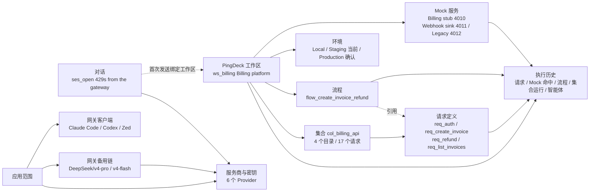

# 演示数据契约（Content Bible）

浏览器 Demo、`?scenario=` 变体、模块级演示适配器与测试假实现共用这一份虚构数据，让所有页面、截图和断言讲同一个故事。

数据契约只定义虚构种子，不是产品规格，也不是真实测试记录。代码里的种子来源如下：

- `src/api/demo/**`：Demo 适配器与会话/设置种子
- `src/features/*/demo.ts`、`src/features/*/seed.ts`、`src/features/*/testing/seed/**`：各模块种子
- `src/test/fixtures/**`：测试读取的精简视图
- `src/features/chat/testing/gen/**`：对话的录制式脚本与故事数据

若文档与代码冲突，以代码为准。叙事段落只解释这些数据在界面上组成什么场景，不能当作仓库测试结果或产品承诺。

## 1. 使用范围与安全

| 用途 | 说明 |
| --- | --- |
| 浏览器 Demo | `npm run dev:demo` / `build:demo`，内存适配器，刷新回到种子 |
| 视觉场景 | `?scenario=<id>&theme=&lang=&w=&h=`，只解析 Demo 构建；桌面构建忽略查询串 |
| 测试假实现 | 组件测试、模块测试、`src/test/fixtures/**` |
| 桌面真实数据 | 不使用这些种子；真实数据在用户数据目录 |

虚构数据规则：

- 业务域名、客户、订单、日志与附件全部虚构。`api.deepseek.com`、`api.anthropic.com` 等真实厂商 URL 只作为服务商预设的基础 URL 显示，种子不对其发请求；业务 API 用 `*.acme.dev` 示例域名，本地地址用 `127.0.0.1`。
- 机密变量的值必须是空字符串；客户端令牌只显示 `pdk_c_••••` 加 4 位十六进制。测试会断言这两点。
- 附件、截图、日志都是演示内容。`gateway-log-1106.json` 只有 `{"requests":412,"failed":37}` 这类摘要，不是真实日志。
- 种子可以被重置、删除、重新生成；不要把用户数据复制进种子。

fixtures 与模块种子不是同一份全集：fixtures 是界面与测试读取的精简视图，只保留部分请求或精简字段，以各自代码路径为准。

## 2. 最小完整场景

这个场景覆盖请求编辑与发送、环境变量、Mock、流程失败断言、历史钻取、服务商与备用链、调用日志、对话审批；不覆盖真实网络、真实 SQLite、真实沙箱或真实导入导出，见 §5。

## 3. 数据清单

### 3.1 工作区、集合与请求

| 项 | 值 |
| --- | --- |
| 工作区 | `ws_billing`，名称 `Billing platform`，同步状态 `LocalOnly` |
| 集合 | `col_billing_api`，名称 `Billing API` |
| 目录 | 4 个目录：Invoices (5)、Customers (4)、Refunds (4)、Webhooks (4) |
| 请求总数 | 17 |
| 关键请求 | `req_auth`、`req_create_invoice`、`req_refund`、`req_list_invoices` |
| 示例标签页 | `tab_list_invoices`（当前）、`tab_create_invoice`（脏）、`tab_get_invoice`（预览） |

目录 id 依次为 `f_invoices`、`f_customers`、`f_refunds`、`f_webhooks`；第四个示例标签页为 `tab_create_refund`。

测试样例视图里的 `REQUESTS` 保留 6 行（GET/POST `/invoices`、GET `/invoices/{id}`、PATCH `/invoices/{id}/finalize`、POST `/refunds`、GET `/customers?email=`），它是界面样例行，不是 17 条种子的全集。

### 3.2 环境

| 环境 | id | 关键属性 |
| --- | --- | --- |
| Local | `env_local` | 无变量覆盖，发送不确认 |
| Staging | `env_staging` | 当前生效；10 个变量；发送不确认 |
| Production | `env_production` | `confirmBeforeSend = true`；默认保护非安全方法，可开启安全方法确认 |

Staging 的 10 个变量（顺序与 fixtures 一致）：

| key | 值/状态 |
| --- | --- |
| `base_url` | `https://billing.staging.acme.dev` |
| `api_version` | `2026-10-01` |
| `token` | secret，值恒为空 |
| `tenant_id` | 空值，演示“未填” |
| `webhook_secret` | secret，值恒为空 |
| `currency` | `USD` |
| `timeout_ms` | `8000` |
| `mock_base_url` | `http://127.0.0.1:4010/v1`（含 Billing stub 的 `/v1` 前缀） |
| `idempotency_prefix` | 禁用 |
| `page_size` | `50` |

### 3.3 Mock 服务

| 名称 | id | 端口 | 路由数 | 启动状态 | 种子命中 |
| --- | --- | ---: | ---: | --- | ---: |
| Billing stub | `mock_billing_stub` | 4010 | 7 | 运行 | 128 |
| Webhook sink | `mock_webhook_sink` | 4011 | 3 | 运行 | 54 |
| Legacy v1 | `mock_legacy_v1` | 4012 | 12 | 停止 | 0 |

关键路由：`GET /invoices` 返回空列表；`POST /invoices` 返回 201。回调 `cb_refund_created` 指向 `http://127.0.0.1:4011/hooks/refund-created`，延迟 500 ms。数据桶包含 `invoices` 与 `customers`。

`POST /refunds` 按序有 422、409、201 三个响应：
- 缺 `invoice_id` 返回 422；请求头 `Idempotency-Key` 为 `dup-1` 返回 409。
- 其余返回默认的 201，带 `x-mock-route: refunds.create`。
- 422 与 201 的 `latency_ms` 为 120。

端口或路径前缀改动后需要停止再启动才生效。

### 3.4 流程（Flow）

| 项 | 值 |
| --- | --- |
| id | `flow_create_invoice_refund` |
| 名称 | `Create invoice then refund` |
| 请求步骤 | 3 步：`step_auth` (Auth)、`step_invoice` (Create invoice)、`step_refund` (Refund) |
| 失败运行 | `run_failed`，512 ms，最后断言 expected 200, got 202 |
| 重试与提取 | Refund 重试 2 次（等 500 ms）；提取 `token`、`invoice_id`、`amount_total`、`refund_id` |

步骤详情：`step_auth` 发 POST `req_auth`；`step_invoice` 发 POST `req_create_invoice` 并断言 201；`step_refund` 发 POST `req_refund`、断言 200，重试条件含 `status_5xx` 与 `status_429`。

界面与 fixtures 把步骤显示为 5 行（Auth、Create invoice、Assert 201、Refund、Assert 200），因为断言单独成行；种子里的执行步骤是 3 个请求步骤。流程每次实际发送 attempt 写一条 `source=flow` 历史，不写响应 Cookie。

### 3.5 服务商、密钥、模型与备用链

六个服务商，按卡片顺序：

| id | 名称 | 基础 URL | 协议 | 密钥 id | 余额/状态 |
| --- | --- | --- | --- | --- | --- |
| `deepseek` | DeepSeek | `https://api.deepseek.com` | Chat、Messages（`/anthropic/v1`） | `key_deepseek_main`、`key_deepseek_backup` | ¥86.40 CNY；TTFT 412/438 ms |
| `anthropic` | Anthropic | `https://api.anthropic.com` | Messages | `key_anthropic_main` | 无余额接口；690 ms |
| `openai` | OpenAI | `https://api.openai.com` | Chat、Responses、Embeddings | `key_openai_main` | 无余额接口；540 ms |
| `moonshot` | Moonshot | `https://api.moonshot.cn/v1` | Chat | `key_moonshot_main` | ¥49.59 CNY；520 ms |
| `relay-acme-dev` | `relay.acme.dev` | `https://relay.acme.dev` | new-api 0.9.7 | `key_relay_main` | $12.40 USD；38 个模型；36/38 |
| `ollama` | Ollama（本地） | `http://127.0.0.1:11434` | Chat | 无 | 本地免费；38 ms |

`relay.acme.dev` 的 38 个模型：31 chat / 3 embedding / 4 image；4 个停用、3 个新增、1 个上游已下线（`llama-3.3-70b`）。两个测试失败：`gemini-3.2-pro` 403 模型未对该密钥启用，`glm-5` 30 s 超时。三个新模型是 `gemini-3.3-flash`、`gpt-6.2`、`deepseek-v4-lite`。

状态原因按启用模型计数，写作 “2 of 34 models failed the last test”，见 `fixtures/demo-conformance/provider-status.json`。

模型对外写成 `服务商名/模型ID`（备用链测试样例使用 `provider_id/model`）：

| 主模型 | 有序备用链 |
| --- | --- |
| `prov_deepseek/deepseek-v4-flash` | `prov_moonshot/kimi-k2.6` |
| `prov_deepseek/deepseek-v4-pro` | `prov_moonshot/kimi-k2.6` → `prov_anthropic/claude-sonnet-5-5` |

不变量：备用链、客户端和日志引用的每个模型都存在于对应服务商的模型集合；provider / client / log 的 id 唯一。

扫描示例：`https://relay.acme.dev` + 掩码密钥 `sk-…7f3c`。证据阶段为 `identify`、`models`、`routes`、`balance`、`key`；`/api/status` 确认 new-api 0.9.7 与 `quota_per_unit 500000`；Chat、Messages、Gemini、Embeddings 返回 400（路由存在），Responses 返回 404；38 个模型；密钥被接受。**演示文案不得承诺“零 token”或“零费用”**；真实扫描与测试台会向服务商发请求，可能消耗 token 或产生费用。

### 3.6 网关、客户端与日志

| 项 | 值 |
| --- | --- |
| 地址 | `http://127.0.0.1:4141` |
| 状态 | 运行 3 小时 12 分；开机自启；LAN 关闭；`token_required = true` |
| 捕获 | `errors_only`，正文保留 7 天 |
| 今日 | 1,284 请求，37 失败，2.41M 输入 token，318k 输出 token，约 $4.82 |

三个客户端样例：

| 名称 | 运行时 id | 默认模型 | 令牌显示 | 今日请求 | 最后活动 |
| --- | --- | --- | --- | ---: | --- |
| Claude Code | `client_claude_code` | `DeepSeek/deepseek-v4-pro` | `pdk_c_••••9d2f` | 842 | 2 分钟前 |
| Codex | `client_codex` | `Anthropic/claude-sonnet-5-5` | `pdk_c_••••41ab` | 311 | 14 分钟前 |
| Zed | `client_zed` | `DeepSeek/deepseek-v4-flash` | `pdk_c_••••c07e` | 131 | 1 小时前 |

fixtures 的客户端视图另用 `cli_claude_code` / `cli_codex` / `cli_zed` 作为 id；它们共享名称、默认模型、掩码与计数，不跨表引用 id。

六条 UI 日志行样例：

| 时间 | 客户端 | 请求模型 | 实际目标 | 协议 | 状态 | 备注 |
| --- | --- | --- | --- | --- | ---: | --- |
| 14:32:08 | Claude Code | `DeepSeek/deepseek-v4-pro` | `deepseek-v4-pro` | Messages | 200 | TTFT 412 ms，总 15.4 s，18,204/912 token，$0.0231 |
| 14:32:01 | Claude Code | `DeepSeek/deepseek-v4-pro` | `deepseek-v4-pro` | Messages | 429 | retry-after 2，等待一次后返回 |
| 14:31:47 | Codex | `Anthropic/claude-sonnet-5-5` | `claude-sonnet-5-5` | Responses | 200 | TTFT 690 ms |
| 14:31:20 | Zed | `DeepSeek/deepseek-v4-flash` | `deepseek-v4-flash` | Chat | 200 | TTFT 233 ms |
| 14:30:55 | Claude Code | `DeepSeek/deepseek-v4-pro` | `kimi-k2.6` | Messages | 200 | 故障转移，TTFT 1.1 s，总 3.2 s，17,950/112 token，$0.0094 |
| 14:28:40 | Zed | `DeepSeek/deepseek-v4-flash` | `deepseek-v4-flash` | Chat | 500 | 上游错误 |

调试抽屉的对象是 `rq_9c41e0b7`（14:30:55）：第一次 `deepseek-v4-pro` 在 148 ms 后 429、retry-after 2；第二次 `kimi-k2.6` 200 并服务。瀑布为 queue 3 ms、Connect + TLS 49 ms、wait 880 ms、首 token 20 ms、流 2,100 ms（合计 3,200 ms）。

### 3.7 对话录制脚本

| 项 | 值 |
| --- | --- |
| 文件夹 | `~/me/PingDeck`，分支 `main` |
| 打开的对话 | `ses_open`，标题 `429s from the gateway`，推理强度 low |
| 用户消息 | 中文：网关这两天老是 429，日志在附件里，截图是 Claude Code 那边的报错，帮查是上游限流还是 router 熔断太敏感 |
| 附件 | `gateway-429.png`（183,204 B，1440×900）、`gateway-log-1106.json`（214,016 B） |
| 工具步骤 | 思考 6 s、读虚构文件 `router.rs`、查网关日志、联网搜 3 源、编辑 +18 −4、跑测试、为 `cargo clippy` 审批 |
| 其他对话 | `ses_compare` 等 6 条（含置顶 `Gateway failover rules`） |
| MCP | `github`（运行中，14 个工具）、`filesystem-docs`（运行中，4 个工具）、`linear`（缺令牌） |
| 技能 | `rust-review`、`changelog-writer`、`api-test-author` |
| 场景：未绑定 | `chat.unbound`：已完成一轮、没有工作区的对话 |
| 场景：失败 | `chat.failUnbound`：`not_bound`、`shell` 退出码 2、通用失败各一行 |
| 场景：计划 | `chat.planApproved`：计划批准后继续改两个文件 |
| 场景：取消 | `chat.cancelled`：绑定 `Payments platform`，取消在改动之后 |
| 场景：暂停 | `chat.queuePaused`：被中断，带一条待发 |
| 场景：关卡 | `chat.running.approval`、`chat.plan.pending`、`chat.question` |
| 场景：列表 | `chat.list.board`、`chat.list.scope` |
| 场景：窄屏 | `chat.narrow.unbound`、`chat.narrow.approval`、`chat.narrow.unbound.fs26` |

其他对话标题依次为：`Compare TTFT across relays`（`ses_compare`）、`Summarise today's request trace`、`Write assertions for /invoices`、新 relay 为什么没有余额接口、`Mock the refunds API`、`Gateway failover rules`（置顶）。

**重要边界**：录制脚本里展示的虚构路径（"crates/pingdeck-core/src/llm/router.rs"）、`14 passed`、`9.2 s`、`cargo clippy` 被拒绝与改动结论都是演示叙事，不是仓库的测试结果、代码变更或真实缺陷，不能引用为测试通过的证据。

### 3.8 AI 请求、测试台与样例

- AI 请求：服务商 DeepSeek、模型 `deepseek-v4-flash`、Chat Completions、流式开。system 为 “You are a terse assistant.”，user 为 “Reply with the single word pong.”。回复 `pong`（TTFT 233 ms，总计 612 ms，9 输入 / 2 输出 token，¥0.00002）。
- 三模型对比：`deepseek-v4-flash` 233 ms、`kimi-k2.6` 520 ms、`qwen3-coder:30b`（本地）38 ms。
- 测试台：`relay.acme.dev`，副标题 “Last run 36/38 ok”，38 个中展示 12 个。检查项覆盖 Connectivity、Auth、Chat、Stream TTFT、tok/s、Tools、JSON schema、Vision、Reasoning 与 Cache，其中 `gemini-3.2-pro` 403，`glm-5` 30 s 超时。

这些也是演示数据。测试台可能对真实服务商产生请求与费用；Demo 不发起真实探测。

## 4. 不变量与边界

| 不变量 | 约束 |
| --- | --- |
| 工作区名、4 目录、6 请求视图、3 环境、Staging 10 变量与 Production 确认 | 设计与样例保持一致 |
| Mock 3 台、Flow 5 步、6 服务商、2 条备用链、客户端计数 `[842,311,131]` 与 6 日志行 | 同上 |
| 备用链与客户端/日志引用的模型存在于服务商集合；id 唯一 | 同上 |
| secret 变量值为空；客户端令牌匹配 `^pdk_c_••••[0-9a-f]{4}$` | 同上 |
| 紧凑数字 `2.41M` / `318K` / `241万` / `31.8万`；金额 `$0.0010`、`$0.0094`、`$12.4000` | 与界面格式化规则对齐 |
| 故障转移日志行的时序段与总和（3,200 ms） | 段宽相加等于总时长 |

## 5. 原型与桌面真实数据边界

离线原型（`docs/design/prototype/index.html`）与测试夹具（`fixtures/`）复用本契约中的虚构实体名与常量。桌面应用（`pingdeck`）不使用这些虚构种子，全部真实业务数据落在用户数据目录的 SQLite 与本地文件中。

## 6. 维护

1. 修改虚构样例名称、模型 ID 或状态文案时同步更新 `fixtures/` 中的对应夹具文件。
2. 禁止将真实用户密钥、真实业务域名或生产日志复制到虚构契约中。
