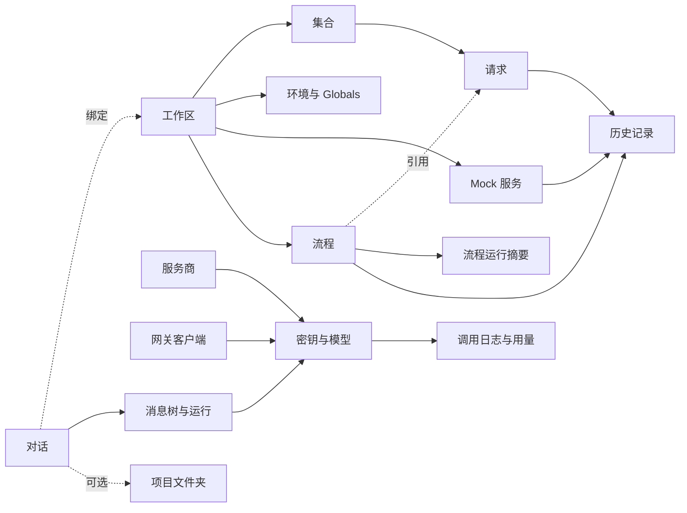

# 产品行为与领域模型

产品手册写每个模块管什么、何时保存、留下什么、限制在哪。验收门槛见 [PRD](product/PRD.md)，机制见[架构](architecture.md)，交互原则见[设计规范](design.md)，取舍理由见[决策记录](decisions.md)。侧栏有九个目的地：API 组（请求、Mock 服务、流程、历史、环境）随工作区切换，AI 组（对话、服务商、用量与日志）所有工作区共用，设置在页脚。

## 1. 壳层、对象归属与保存语义

### 五种作用域

| 作用域 | 包含什么 | 边界 |
| --- | --- | --- |
| 应用 | 设置、服务商与密钥、模型目录与价格、网关与客户端、智能体配置、MCP 与技能 | 所有工作区共用同一份 AI 配置 |
| 工作区 | 集合、目录、请求、环境、Globals、Cookie、证书、Mock 服务、流程、历史 | 数据库里的一个分组，同一 OS 用户的程序都读得到 |
| 环境 | 命名变量、声明的主机、发送前确认 | 名字叫 Production 不带来保护 |
| 对话 | 消息树、模型、权限模式、说明、项目文件夹、绑定的工作区与环境 | 文件夹、工作区和对话是三个对象 |
| 一次运行 | 输入快照、目标、步骤与尝试、临时变量、进度与结果 | 停止只取消没做完的部分 |

对话可以不绑定工作区，照常发送。绑定在首次发送时完成（起始页选的工作区，默认是当前活动工作区，可选“不绑定”），或随时由头部显式补绑，下一条消息起生效；之后切换壳层工作区，对话的工作台工具仍指向绑定的那个。头部写出绑定的工作区与环境，空闲时可以换，运行中不能换。删除工作区前，确认框写出会解绑几个对话。项目文件夹是用户选的磁盘目录：文件工具限制在里面，shell 以它为工作目录。

| 能力 | 取决于 |
| --- | --- |
| 请求与环境工具：发送、追踪、列出与读取请求、列出环境、创建请求 | 工作区绑定；未绑定时这六个工具不进工具表，系统提示写明没有工作区 |
| 文件与命令工具 | 项目文件夹与沙箱 |
| 探测、调用日志、联网、附件 | 两者都不依赖 |

### 主要对象关系

集合与目录给请求提供认证、脚本和变量的继承链。流程步骤引用已保存的请求，内联步骤没有请求身份。被引用的对象删掉后，引用方显示缺失，不会改用同名对象。HTTP 往返落历史，叫**记录**；模型调用落调用日志，叫**调用**；用量是调用的汇总。同一次执行在两边都有记录时，两条记录能互相跳到。

### 哪些会保存，哪些只在当前进程存在

每类可编辑对象只用一种保存方式。**文档型**显式保存，有未保存标记，离开前询问：请求标签、环境、集合设置。**配置记录型**改动后自动保存，头部显示保存状态，失败可以重试：Mock 服务、流程、服务商配置、网关客户端。**字段型**失焦或切换即写入：设置页的字段。

| 类别 | 存在哪里 | 恢复边界 |
| --- | --- | --- |
| 业务对象 | 主数据库 | 重启后可读，受删除与保留设置影响 |
| 秘密值 | 主库旁的明文保险库 `<db>.secrets`，Unix 权限 0600 | 普通读取只返回是否已存与尾号 |
| 内容文件 | 数据目录里的附件、工具输出全文、改动前快照、客户端配置原件 | 只复制数据库不完整 |
| 请求标签草稿 | 主数据库，按工作区 | 恢复编辑内容，在途发送与追踪不恢复 |
| 对话输入草稿、界面偏好 | 本机浏览器存储 | 不参与配置同步 |
| 运行态 | 进程内存：监听器、连接、审批、进程、密钥冷却、撤销记录 | 页面重载后还在，进程退出就没了 |

保存与启用分开：保存 Mock 只写配置，启动后才监听；添加服务商后要探测才知道模型能不能用；导入的 MCP 服务器要用户信任才会启动；保存流程不触发运行。

已存的秘密只显示“已存”与尾号。编辑时留空表示保留，填新值表示替换，显式清除表示删除。复制由核心直接写剪贴板，界面拿不到明文。服务商 API 密钥可以限时查看，网关客户端令牌只在创建和轮换时显示一次。字面量认证、请求正文、脚本、附件和导入文件可能含明文，它们不进保险库。

### 在模块之间交接

跨模块跳转分三种：

- 证据边落到只读记录：历史记录、调用、用量、流程运行、Mock 流量、集合运行结果。任何模块都可以链过去。
- 定义边落到可编辑对象，只能沿顺序往后：对话 → 历史 → 流程 → Mock 服务 → 请求 → 环境 → 用量与日志 → 服务商 → 设置。设置是终点。
- 派生边新建草稿：打开为草稿、问智能体、在请求中试用、建为流程、用相同设置再运行。新对象不带回到来源的链接。

每次跨模块跳转都能用「返回」或 ⌘[ 回到来源；从侧栏或 ⌘K 直接切模块时清空返回记录。交接只带有限、脱敏的上下文：问智能体附上芯片，不自动发送，也不授予工具权限；新的交接替换上一次交接加入的芯片，同一对象不重复加入，你自己加的芯片保留；草稿里已有你写的文字时先询问是替换还是保留。从历史打开请求不会发送。

导入只有一个对话框（工作区菜单 › 导入…）。它识别 Postman、cURL、OpenAPI、HAR、Insomnia（v4 JSON）、Bruno 与 Hoppscotch 集合导出、环境、Mockoon 与 PingDeck Mock 导出。cURL 直接开成请求草稿，不写库；`-L`、`-k`、`-m`、`--retry`、`-x`、`--http1.1`、`--http2` 变成请求的网络选项，换不过来的选项列在说明里。Postman 与 OpenAPI 的响应示例存在请求上，每个请求最多 20 个，单个正文 64 KiB；请求的「说明」页列出这些示例，可以逐个删除，保存请求后生效。

导入同名集合时默认“更新”。文件里的请求先按方法加 URL 路径、再按目录里的名称与已有请求配对，配对上的保留 ID，Flow 步骤与历史仍指向它。“更新”只刷新文件拥有的字段，用户补的断言、脚本、网络选项和填好的值保留，文件里没有的请求也保留。“替换”让集合与文件一致，配对上的请求同样保留 ID，其余的移除。两者都能撤销。

导出在集合、环境、Mock 服务各自的菜单里，默认把字面量凭据留空。凭据位置与复制为代码、配置同步相同：认证字段、凭据名请求头、凭据名查询参数与表单字段、URL 用户信息。集合导出默认不带环境；选了环境时，环境变量覆盖同名的集合变量。

Postman 导出把断言写成带标记的 `pm.test`，Postman 跑不了的写成跳过的测试，重新导入时还原成断言。重定向与 TLS 选项写进 `protocolProfileBehavior`；导入时文件里关闭证书校验（`strictSSL: false`）或跨重定向转发 `Authorization`（`followAuthorizationHeader: true`）的值不生效，只在预览里警告，要放宽须由你在请求的网络设置里自己改。单请求超时、重试和代理 Postman 存不下，导出时逐类列出。请求、目录和集合可以“复制到…”本工作区或别的工作区，副本用新 ID，在一个事务里写入。

模块第一次打开后保持挂载，隐藏时任务继续跑。后台任务都登记在侧栏页脚的「正在运行」，等你处理的事在「需要你」里；需要关注或连不上的服务商另有一条提示，直达服务商模块。页面看不见，任务仍可能在跑。macOS 上关窗只隐藏窗口，网关、Mock 与 MCP 继续服务，菜单栏图标写出在跑的服务，点 Dock 图标或菜单栏的“显示 PingDeck”回到窗口，⌘Q 才退出。同一数据文件夹只能有一个 PingDeck 进程，第二份会提示已在运行后退出。

### 事实所有权

一个事实只在一处编辑，其他位置只读显示并链到那一处。

| 事实 | 编辑处 | 其他位置 |
| --- | --- | --- |
| 已保存请求的定义 | 请求 › 标签编辑器 | 流程步骤只读摘要，带「在请求中打开」 |
| 集合与目录的认证、脚本、变量 | 请求 › 集合设置 | 变量弹层只读显示 |
| 环境变量、Globals、保护、声明的主机 | 环境 | 变量弹层只读，带「在环境中编辑」 |
| Cookie 与工作区证书 | 环境 › 连接 | 响应的 Cookie 标签只读本次 Set-Cookie，并写出是否已存入 Cookie 罐、哪些 Set-Cookie 没保留及原因 |
| 全局代理、CA 文件、请求默认值 | 设置 › 网络、设置 › 请求默认值 | 请求网络标签显示继承值与来源 |
| 服务商、密钥、端点、模型声明值 | 服务商 | 各处模型选择器读同一份模型列表 |
| 网关访问、客户端、备用规则 | 本地网关（独立模块） | 侧栏「本地网关」项显示端口，页脚「后台工作」列出运行状态 |
| 模型目录与价格 | 设置 › 模型 › 模型与价格 | 服务商模型行、用量、AI 响应只读生效价 |
| 已完成运行的逐条结果 | 历史，按运行分组 | 集合运行标签与流程结果只看本次 |

### 排错的四个问题

1. 对象属于哪里？先核对工作区、环境、对话与项目文件夹，避免对同名对象下结论。
2. 看到的是哪个时间点？草稿、已保存定义、运行快照和历史预览可能不同。
3. 动作发生了没有？被拒绝、未派发、发出后取消、HTTP 成功但保存失败，各有不同的恢复办法。
4. 证据完整吗？截断、脱敏、日志丢弃和费用估算都会影响结论。

### 默认值与覆盖

能覆盖默认值的字段只有三种语义：“跟随设置（实时）”每次使用时读当前设置，“新建时取值”只在创建时复制一次，“本对象自定义”用自己存的值。界面显示继承值与来源，并给“恢复跟随”。设置行写明改动何时生效，例如“修改会重启网关”。

## 2. 请求：定义、草稿和一次执行

拥有什么：请求模块管集合、目录、请求、标签草稿、集合运行结果和控制台。请求类型有 HTTP、GraphQL、AI 三种，GraphQL 是 HTTP 请求体的一种结构。AI 请求选服务商时，目标地址与凭据由核心决定：前置脚本跑完后核心重新锁定目标，丢掉脚本或用户写的 Host 与认证头。切回 HTTP 时注入的密钥不留在草稿里。

认证从请求往外找：请求、最近的目录、外层目录、集合。脚本按集合、根到叶的目录、请求的顺序跑，前置与后置各一轮。同名变量从低到高覆盖：工作区 Globals、集合变量、本次选定的环境、集合运行的数据行、Local（脚本临时值、流程初始值与提取值）。

超时、重试、HTTP 版本、跟随重定向、最大重定向次数、TLS 校验、代理这七项，每个请求逐项选“跟随设置”或“本请求”，新建时全部跟随。超时是空闲超时：建连、等响应头或等下一段正文超过它才放弃，持续发数据的流不会被切断；每个请求另可设总时限，覆盖重定向和正文，留空时单次发送不限，集合运行与 Flow 步骤按 5 分钟算。跟随设置的代理按一条规则走：本机与 `no_proxy` 里的主机直连，其余用设置里的全局代理，全局选“系统”时用系统代理。选“本请求”且代理留空时直连。失败卡写出这次实际用的代理和它的来源。

何时保存：请求标签是文档型，⌘S 保存。发送用标签里当前的内容；环境变量只用已保存的值。一次调用指定了环境时，生产守卫检查的就是这个环境。集合运行的结果开成请求模块里的一个标签，摘要按集合保存最近若干次，可以从历史重开。

操作留下什么：每次发送写一条历史记录，带请求快照、响应预览、断言计数和环境。写历史失败时响应照常显示，并提示这次没有写入历史。同一标签同时只有一次在途发送，重发时旧响应留到新响应到达。集合运行在第一次发送前对受保护环境先确认，确认框写出要发的请求数，拒绝就一个都不发。集合运行和流程都能跑 AI 请求，AI 步骤只按请求自带的断言判定。

请求校验失败、网络失败、HTTP 错误、断言失败、脚本失败是五种结果。收到 500 是一次有响应的交换；收到 200 但断言失败算检查失败。前置脚本抛出异常会挡住主请求，后置脚本失败时保留已有响应和诊断。

断言除固定种类外，还能写成“目标 + 运算符 + 期望值”（取反、大小比较、正则、类型判断），或用 JSON Schema 校验整段正文或某个 JSON 路径，OpenAPI 文档里的 schema 可以直接贴进去；脚本里有 `pm.response.to.have.jsonSchema` 与 `tv4.validate`。

脚本的 `CryptoJS` 提供 MD5、SHA1、SHA256、SHA512 与 HmacSHA1、HmacSHA256、HmacSHA512；旧式的 `postman.setEnvironmentVariable`、`getEnvironmentVariable`、`setGlobalVariable` 等变量调用与 `postman.setNextRequest` 映射到对应的 `pm` 接口。导入预览会列出沙箱没有的接口（如 `require`、lodash 的 `_`、`CryptoJS.AES`）。

脚本里的兼容层：

- 断言按 chai 的规则判定。拼错或不支持的断言词（如 `to.be.sucess`）让测试失败，不会读到空值后误判通过；深比较不看键顺序，缺键与值为 `undefined` 的键不相等，`NaN` 与 `NaN` 相等。
- `pm.sendRequest` 按正文的 `mode` 编码 `raw`、`urlencoded`、`formdata`（只含文本字段）与 `graphql`，带文件的正文在发送前报错。`pm.request.body.update` 也接受 `{ mode, … }`。
- `pm.cookies` 在前置脚本里就能读到请求 URL 会带的 Cookie，后置脚本再叠上本次响应设置的 Cookie。`pm.cookies.jar()` 只能读写请求主机及其父域、子域的 Cookie；写入立刻用于本次主请求，记录型发送且请求使用 Cookie 罐时再存进罐里。
- 脚本新建的变量名称像凭据（`token`、`client_secret`、`session_id` 等）或值像令牌（JWT、服务商密钥、`Bearer …`）时存为机密，导出与同步不会带出明文。覆盖已有机密时保持机密，写进空占位变量的凭据也让它变成机密。
- 写入已停用的变量只更新值，变量保持停用，控制台给出提示。导入预览的兼容扫描会列出脚本里不支持的断言词和文件正文。

OAuth 2.0 在发送时先用令牌卡片取到的令牌；它过期而存有刷新令牌时自动刷新并存回。客户端凭据与密码授权重新取令牌并缓存在内存里，同一配置同时发出的请求只取一次令牌。服务器对令牌返回 401 时换新令牌（刷新或重取）重发一次，拿到新令牌后才丢弃被拒的那枚；换不到新令牌就返回这次 401，原令牌保留，没有刷新令牌的卡片令牌不会因预期内的 401 失效。

额外参数（`audience`、`resource` 等）随每次令牌请求发送，也加在授权 URL 上；与授权方式自身字段同名的参数不发送。取令牌、脚本的 `pm.sendRequest` 与主请求信任同一组根证书，出示同一张匹配主机的客户端证书。

客户端证书可以是 PEM 证书加私钥（私钥可设口令，口令存在秘密库），也可以是 `.p12`/`.pfx` 文件；旧式 OpenSSL 加密的私钥要先转成 PKCS#8。响应按 `Content-Encoding` 解码 gzip、deflate、br 与 zstd。

响应头到达之后，空闲超时、总时限和停止都保留已收到的部分：状态码、响应头和收到的正文照常显示，并标明正文提前结束及原因。正文超过捕获上限时，响应头写出已捕获大小与真实大小（未知时标“+”）；「发送并保存到文件」先选文件，再把完整正文写进去，不受上限限制。

限制：停止只取消等待和可取消的 I/O。已到服务端的操作不撤销，前置脚本已提交的变量不回滚，脚本发出的附加请求可能已经发生。执行器会对幂等方法或连接阶段的失败做传输重试，所以一条历史记录可能对应多次上游请求。生产确认同样拦脚本的 `pm.sendRequest`：受保护的方法没有确认就被拒，这次发送已确认（智能体的发送已在审批卡上批准）时随之放行。智能体生成或改过的请求另有主机与凭据边界（§7）。

## 3. Mock：配置和活数据

拥有什么：Mock 模块管 Mock 服务、路由、响应、数据桶、回调、转发和流量。Mock 是只监听回环的真实 HTTP/1.1 服务（`127.0.0.1`，本机有 IPv6 时同一端口也听 `[::1]`），本机其他程序都能调用。服务可以选一个环境，环境的普通变量填进转发目标、回调地址和头，秘密变量不展开；「发布 Mock 地址」把监听中的地址写成环境变量 `mock_base_url`。

一条路由的多个响应按模式选，语义同 Mockoon。按规则顺序（默认）返回第一个规则全部满足的响应，没有规则的响应不参与比较；都不中返回默认响应，没有默认返回第一个。回落的比较方式相同，都不中时让给下一条路由。顺序与随机轮流或随机返回，不看规则。停用规则每次返回默认响应。请求带 `Prefer: code=404` 这类头时，直接返回该状态码的第一个响应，不看规则与模式；没有这个状态码的响应就照常选。这样 OpenAPI 生成的 4xx、5xx 响应也能被请求到。

响应正文有三种来源：模板文本（默认）、Base64 字节（解码后原样发送，适合图片等二进制）、本地文件（绝对路径，每次请求读取，不渲染模板）。后两种最大 1 MiB，读不到或超限时返回 500 并写明原因。响应还可以设故障：挂起（等完延迟后不响应，60 秒后或停止服务时断开）或断开（不发任何字节直接关连接），流式响应以外也能模拟。

模板是带上限的 Handlebars 子集，认识 `{{#repeat}}`、`{{#each}}`、`{{#if}}`、`{{#unless}}`、`{{else}}`、括号子表达式和 `key=value` 选项。助手有请求取值（`urlParam`、`queryParam`、`header`、`body` 等）、`data`、随机数、`now` 与 `date`（date-fns 格式）、`faker`（常用的 Faker.js 方法）、`oneOf`、比较与逻辑（`eq`、`and`、`not` 等）和字符串助手。

一次渲染最多输出 1 MiB，单个块最多循环 1000 次、合计 10000 次，嵌套最多 16 层。不认识的助手原样输出；块没有正确闭合时，整段按无块处理。

何时保存：Mock 服务是配置记录型。运行中保存路由、响应和规则立即生效；端口要停止后才能改，前缀改动重启后生效。CRUD 路由的数据桶改动只在运行中的服务里：普通保存保留桶内数据，改桶的初始值会重置该桶，重启从初始值重建。「复位状态」把顺序游标、请求序号和命中数归零，数据桶与流量保留。停止前有改过的桶时先确认。

操作留下什么：每个请求写一行流量，记下结果（命中、转发、转发失败、未命中、主机被拒、跨站写被拒、连接已满）、为什么选中这个响应、回调结果。命中路由的请求另写一条来源为 Mock 的历史记录。流量行可以「在请求中打开」，未命中或转发的行可以「存为路由」，「从日志添加」列出最近 20 个不同的方法与路径。「试一下」只留 Mock 自己那条历史。导入 OpenAPI 时可以同时生成一台未启动的 Mock 服务，每个操作一条路由。

流量行的正文只留前 64 KiB，用截断的行建路由时会标明。转发页可以开启录制：录制期间每个转发的响应完整留在内存里，每个方法与路径一条，以最新为准，最多 200 条、合计 32 MiB，服务停止即清空。「存为路由」只为还没有路由应答的请求加路由，二进制正文和含 `{{` 的文本正文存成 Base64，按原样回放、不当模板渲染。录制过的流量行「存为路由」时也取完整正文。

限制：Host 不是本机的请求返回 403。Android 模拟器（`10.0.2.2`）或 Docker Desktop（`host.docker.internal`）要访问时，在服务设置页的「额外允许的主机」里添加，添加前要确认。这个列表对所有 Mock 服务生效，监听地址仍只是回环。启动时若另一个程序占着 `[::1]` 上的同一端口，按端口冲突报错，免得把 `localhost` 解析成 `::1` 的客户端连到别处。

GET、HEAD、OPTIONS 以外的请求带非本机 `Origin`，或带 `Sec-Fetch-Site: cross-site` 时返回 403，不碰路由、数据桶、回调和转发。转发和回调会向外发请求：开启转发前要确认，转发时带上全部请求头，包括 Authorization 与 Cookie。转发两个方向都逐字节传递正文；上游响应超过 1 MiB 时返回 502 并写明原因，不截断转发。

导入 Mockoon 配置不开启转发、不绑定回调。文件正文保留路径，相对路径要改成绝对路径才能用；导入 Mockoon、PingDeck Mock 导出或同步来的 Mock 文档时，警告里逐个列出文件正文指向的本机文件，服务启动后这些文件会发给访问它的客户端；数据桶正文转成 `{{data '桶名'}}`。PingDeck 不渲染的模板助手逐个列进警告，无法求值的规则保留为永不满足的规则（请求序号等于 0）。

导出 Mock 服务默认把代理请求头和回调头里的字面量凭据、转发目标与回调 URL 里的用户信息和凭据名查询值留空并提示数量，勾选「包含字面量凭据」才写出原值。流量只留有限的头与正文预览，容量在「设置 › Mock 服务」里设。

## 4. 集合运行与流程

拥有什么：流程模块管流程定义、初始变量、运行选项和最近的运行摘要；集合运行属于请求模块（§2）。流程是有依赖的竖向步骤列表，前一步提取的值给后一步用。步骤引用已保存的请求或内联一个请求，可以提取变量、加断言、设等待、写“仅当…时运行”的条件、设重试与超时。流程不是任意图引擎。

- 判定：先按已保存请求自带的断言，再按步骤自己的断言；步骤可以显式忽略请求自带的断言。
- 运行前检查范围内每一步：缺请求或所选请求不存在时一个请求都不发，报错写步骤序号和名字。
- 运行方式有三种：完整运行、运行到此（执行前缀）、只运行此步。后两种的起步变量取初始变量加上次运行结束时的变量：优先取本次会话最近一次运行，重启后取最近一次存储的运行（机密值不入库，界面列出没有沿用的名字）。上次运行用的是另一个环境时不沿用它的变量，界面提示一句；Cookie 不沿用。
- 条件（“仅当…时运行”）支持 `==`、`!=`、`contains`、数值比较 `>`、`>=`、`<`、`<=`，用 `and`/`&&`、`or`/`||`、`not`/`!` 和括号组合；含空格或运算符的文本加单引号或双引号；只含一个 `==`、`!=` 或 `contains` 而语法不认的条件（如 `{{status_text}} == Bad Request`）按运算符两侧的整段文本比较。条件写错时保存被拒，错误挂在条件字段下；条件不成立的步骤直接跳过，不等待；运行时无法求值的条件（例如数值比较遇到非数字）让该步失败。
- 内联步骤可以写方法、URL、查询参数、请求头和请求体，并选请求体类型（JSON、纯文本、XML、HTML、JavaScript、URL 编码表单）。从已保存请求切到内联时，方法、URL、查询参数、请求头和请求体连同步骤的覆盖项一起复制过来，Bearer 与 API Key 认证按原样写成对应的请求头或查询参数。其他认证、从集合或文件夹继承的认证、脚本、断言、路径变量和多部分或文件请求体无法内联，不复制并在提示里逐项列出，网络选项也不复制。请求体覆盖默认沿用已保存请求的类型；已保存的是 GraphQL 请求时，覆盖文本是查询，变量沿用请求里的。
- 提取项可以标为机密，凭据名（如 `token`、`api_key`）、Cookie 和凭据请求头默认是机密。机密值在后续步骤的历史里打码，也不进运行摘要。

何时保存：流程是配置记录型。初始变量和运行内 Cookie 开关随流程保存。流程用当前环境运行，与请求模块共用同一个环境选择器。

操作留下什么：每个已发送的步骤尝试写一条来源为流程的历史记录，带运行 ID。运行结束或取消后保存摘要：运行范围，每一步的状态、断言计数、失败种类、跳过时的条件与历史记录 ID。完整响应正文只在本次结果里，重启后经历史记录查看。脚本对已保存作用域的修改照样持久化；提取的变量和脚本用 `pm.variables` 写的局部变量只在本次运行内可见，后面的步骤读得到。摘要另存运行用的环境和结束时的非机密变量，供重启后的部分运行起步。

限制：步骤重试只针对配置的 5xx、429、网络等故障，断言失败不重试，条件不成立的步骤尝试数为 0。流程不把响应 Cookie 写回工作区的 Cookie 罐；同一次运行里，后面的步骤带上前面步骤收到的 Cookie，可以关掉。摘要保留的次数见 `PRD.md` §3。

## 5. 历史、追踪与捕获

拥有什么：历史模块管本工作区全部 HTTP 往返的记录，按运行分组。来源有五种：请求、集合运行、流程、Mock、智能体工具。每条记录带请求快照、响应预览或失败、环境、耗时与断言计数，并写明来自哪个对话、哪次流程运行或哪次 Mock 命中。失败只有一个定义：传输失败、状态码不小于 400，或有断言未通过；筛选与运行组计数共用它。

请求快照是发送前的定义：脚本改动之前，继承的认证保留为“继承”，不把集合或文件夹的凭据复制进每一行。“再次运行”和“作为草稿打开”按记录时的集合与文件夹现在的认证重新解析，草稿离开集合，所以集合变量和集合脚本不参与，请求自己的前置脚本在干净的定义上只跑一次。快照超过 256 KiB 时不保存，这条记录不能再次运行，按钮说明原因，仍可作为草稿从 URL 重建。把某个值“存为机密”后，本工作区历史快照、已发送请求和 URL 里的这个值改写成 `{{变量名}}`。

搜索匹配名称、方法、URL、状态、错误、来源与环境（大小写按 Unicode 折叠），也匹配响应正文预览、响应头和已发送的请求（请求头已打码）；正文与头只对 ASCII 不分大小写，非 ASCII 字符按原样匹配。

保留：请求、智能体、集合运行、流程四类来源各自按「设置 › 数据与同步」里的条数保留，互不挤占；集合运行与流程按整次运行淘汰，最新一次运行总是完整保留。Mock 命中单独限额 500 条。

| 证据 | 用来判断 | 限制 |
| --- | --- | --- |
| 历史记录 | 发了什么、从哪来、结果与断言 | 正文是预览，凭据可能已失效 |
| 实时追踪 | 本次的变量、认证、传输、重定向与时序 | 只属于本次发送，从历史打开不重建 |
| 流程运行摘要 | 每一步的状态、断言计数、失败种类 | 正文经历史记录看 |
| Mock 流量 | 为什么命中、实际请求与响应预览 | 截断的正文不能完整重放 |
| 调用日志与捕获 | 实际目标、尝试、用量、转换说明 | 捕获有配额，费用是估算 |

何时保存：发送完成时写入；历史与 Cookie 写回分开提交，写历史失败不把成功的响应改成失败。保留条数在「设置 › 数据与同步」里设，按来源分别计数（见上文），一次集合运行冲不掉手工发送的记录。清除历史只在历史模块的面板菜单里；删除的行就地清零，文件要在「数据与同步 › 存储」压缩数据库后才变小。

操作留下什么：打开记录只读查看，不发送。「再次运行」在当前环境或记录里的环境重发，产生新记录；也可以打开为草稿不发送。导出 HAR 时遮蔽密钥头、URL 里的凭据和令牌形状的正文，截断的正文在文件里标出。默认范围是全部时间，默认不含 Mock 来源。

限制：从历史打开的请求带旧结果，追踪不重建。网关重放走当前路由，旧捕获被脱敏、截断或缺失时不能字节级复现。审计或备份要显式导出并检查完整性。

## 6. 环境

拥有什么：环境模块管命名变量、声明的主机和发送前确认，Globals 也在这里，Cookie 与工作区证书在「连接」分组。「已解析」视图列出一个变量在环境、集合、Globals 和运行时各层的值与覆盖关系；「对比」并排看两个环境，缺的键回落到 Globals。当前环境可以在环境模块里「设为当前环境」，也能用 ⌘K 切换。从没选过时取第一个环境；当前环境被删后变成“无环境”，撤销删除即恢复。

何时保存：环境是文档型，编辑产生草稿，⌘S 保存后才参与发送。就地「定义变量…」直接写入一个变量；从认证字段进来时默认勾选“存为机密”，目标里已是机密的同名变量保持机密，改成普通变量只能在编辑器里显式切换。粘贴 `.env` 时，凭据名（如 `*_TOKEN`、`*_SECRET`、`*_PASSWORD`、`*_API_KEY`）的新行直接存为机密，提示里可以“保留为文本”。秘密变量按 §1 的三种意图修改，已存的秘密显示尾号，可以复制，没有查看。值为空的机密仍算定义，会遮住下层的同名值并报未解析。

Cookie 罐可以手动添加：填主机或 URL、路径，再输入一个 `name=value` 或粘贴浏览器里的整条 Cookie 头；导入接受 Cookie 罐 JSON 和 Netscape `cookies.txt`。

操作留下什么：保存后其他模块重读环境；智能体、OAuth 与配置同步写入环境时同样通知。删除环境立即执行，提示里给撤销。

限制：声明的主机决定秘密能发往哪里，变量值和已保存请求里的主机、本机 Mock 服务和网关都算已声明；另一个环境声明而本环境没声明的主机，不会因为有已保存请求指向它就算本环境已声明。智能体写过的请求要等用户在确认卡上接受目标主机（或目标本来就已声明）才开始声明主机；集合运行和流程遇到这类会把凭据发往未声明主机的请求，会整次拒绝并提示先单发复核。流程的步骤覆盖了 URL，或前面步骤提取的值改变了目标主机时，这一步在发送前同样被拒绝。发送前确认按环境开启，可以选择连 GET、HEAD、OPTIONS 也确认。智能体的发送每次都确认；没选环境或选了别的环境时不确认。

## 7. 对话：上下文、授权与改动

拥有什么：对话模块管消息树、运行、计划、权限模式、说明、附件、改动记录和项目文件夹引用。编辑用户消息或重试产生分支，旧回答保留。计划属于分支头，权限模式属于对话。运行由核心持有，切模块或重载页面不会停。

标题与上下文：自动标题只取第一条消息里你自己写的文字；消息只带上下文（问智能体时没打字）时，取第一个上下文的标签。随消息带上的请求、历史、网关日志、探针或断言在气泡里显示成芯片，默认收起，点开看模型收到的内容；标签原文不进标题、气泡正文和复制结果，模型仍收到完整内容。每个上下文单独存成一段，正文里的结束标记由核心转义，响应正文伪造不出芯片。

发送前，输入框里的芯片弹层只显示前 40 行，“显示全部”打开完整的外发文本，并标出 PingDeck 发送前替换掉的值（`{{secret:名称}}`、`••••••`、`<redacted>`）；遮盖只是尽力而为，其余内容要自己看过。

编辑这条消息时芯片保留，只改你写的文字，可以去掉附件，已清理的附件不随编辑上传；编辑没有被核心接受时编辑框和改好的文字保留。

发送与排队：底栏常驻五项：`+` 菜单、模式芯片、上下文环、模型、发送或停止。模式芯片同时呈现权限与计划，状态仍是三档权限加独立的计划开关；默认 ⌘⇧O 的“轮换模式”在自动批准只读、每次询问、计划之间轮换，跳过完全权限。运行中 ↵ 排队，⌘↵ 在当前工具结束后引导，⇧⌘↵ 停止并发送；审批在等时 ⌘↵ 无动作，菜单另给“引导并取消这次批准”。

停止后队列暂停：暂停条整行写出原因与待发数，主按钮“继续发送”；暂停时再发的新消息直接发出，菜单给“清空待发并发送”。重启后不声称暂停，只显示“待发 N”。

模型的写法：对话里每个点名模型的地方（模型芯片、页脚路由行、“由 X 回答”、等待提示、子智能体行、用量弹层）都写 `服务商名/模型ID`，推理强度生效时加 `:强度`，如 `openai/gpt-6.1-sol:high`。

强度取实际发出的档位：芯片取对话当前强度，页脚取那条回答自己记录的档位；自动档、模型无推理控制和没有记录的回答不加。服务商名按当前显示名解析，认不出的保留原字符串。

线程：工具调用折叠成过程块，运行中写“工作中 · n步”，完成后写“已工作”加用时；计划与提问各有自己的块，过程块按时间切段。工具失败只画一行并默认收起，写本地化类别、退出码或“展开查看原因”，行动按钮给下一步；后端原文只在展开后的技术细节里出现。回合末有改动时给改动条（审阅改动、全部保留），逐文件撤销在面板“改动”页。

需要你的事只在输入框顶部的关卡区处理，线程里只有一行不可操作的标记；计划被批准、要求修改或超时，都在计划块上留痕。关卡区放不下时审批卡折叠成一行：shell 写出命令的第一行，只有整条命令是一行且完整显示时才在折叠行给“允许一次”，多行或被截断的命令、差异、URL 和参数都要先展开。“全部允许 N”逐条写出每个调用的完整目标：完整 URL、路径与增删行数、命令或工具名加完整参数。

删除一轮：确认前总是向核心预览，写出这条路径上之后的轮数、其下保留的其他分支（重试或编辑）数和随之删除的改动记录数。还有待复核的改动时，默认按钮是“复核改动”，要删除得明确点“仍然删除”，这些改动从此不能再撤销。回答的“更多”菜单另有“在调用日志中查看”，打开用量与日志的调用段，按这次运行筛选（搜索框里是 `run:<运行 id>`）。

对话列表：默认按时间分组，视图菜单可切到“运行看板”（需要你、运行中、最近完成，同一份行数据），也可按当前工作区或项目文件夹收窄。搜索和范围都由核心在全部对话里分页筛选（标题与消息正文），没加载过的旧对话也能命中，滚到底继续翻页；点有正文命中的行直接打开到那条消息，与命令面板一致；搜索失败时写出原因，不保留上一次的命中。“需要你 N”条与范围无关，点它打开第一个需要你的对话并聚焦关卡卡；运行中组头有“停止全部运行…”。

分支为新对话：把从开头到这条回答的路径复制成一个独立的新对话，模型、文件夹、技能、联网和计划随之复制，运行记录和用量不复制，完全权限降为自动批准只读。新对话沿用原标题，不加后缀；列表行在标题前显示分支图标，对话标题下方显示「分支自 原标题」，点它回到原对话；原对话删掉后只显示「分支对话」。最后一轮不提供这个操作，因为它等于复制整段对话：换一个回答用重试，换一种问法用编辑。

主智能体用 `task` 把独立的活交给子智能体。子智能体只看到任务说明和全局的“我的说明”，做完交回最后一段文字，前面一行写角色、模型和花费；它不能再派子智能体。「设置 › 智能体 › 子智能体」给快速、深度思考、看图三个角色各配一个模型和备用链，角色只决定用哪个模型，不放宽权限。

系统提示依次是基础部分、全局的“我的说明”、对话自己的说明、项目文件夹里的 `AGENTS.md`（没有就读 `CLAUDE.md`，只读受信任的文件夹）。信任在对话里授予，在「设置 › 智能体 › 项目指令与信任」里查看和取消信任，「权限」页有指向它的入口。PingDeck 没有自动记忆。

| 选择 | 授权内容 | 仍然生效 |
| --- | --- | --- |
| 每次询问 | 普通外部动作逐次问 | 计划与进程管理等内部工具按各自规则 |
| 自动批准只读（默认） | 合适的只读工具直接跑，写入与网络继续问 | 敏感路径仍强制询问 |
| 完全权限 | 跳过普通的逐次审批，持续到应用重启 | 硬阻止、规则 Block、强制询问、OS 沙箱、未受信任的 MCP 工具 |
| 计划（独立开关） | 只读分析，提交计划等你批准 | 核心拒绝写工具 |
| 信任文件夹 | 注入该目录的项目指令和技能 | 指令变化后要重新信任 |

权限判断有固定的分层顺序（见 `architecture.md` §11），审批卡写出是哪一层要问你。记住的规则只在本对话或本文件夹这类窄范围匹配，每次使用前重新检查。网页、MCP 结果、模型输出和项目指令都是输入，不能授予权限。MCP 服务器有未受信任、受信任、定义已变待复核三种状态，启用 stdio 服务器前界面显示完整命令。

何时保存：消息、运行、工具调用、审批结论和改动记录随运行写入数据库，输入草稿只存本机。等你处理的事有四种：审批、智能体的提问、计划批准、费用暂停，在「需要你」里共用一个计数。窗口在后台时，等你处理的事默认发系统通知；在「设置 › 通用」里可以关掉，或改成连 30 秒以上运行的结束也通知（默认不通知运行结束）。通知只写工具类别与风险或运行结果，不写命令和路径。

操作留下什么：每次模型调用进调用日志与用量，子智能体和上下文压缩也算。超出上限的工具输出全文落盘，模型用 `read_output` 翻页读，「设置 › 数据与同步」里可以清理。文件工具写前保留原文、写后可看差异，逐文件撤销只写回改动发生时的项目文件夹。

智能体改动的记录：`create_request` 新建或修改的请求也进改动记录，可以看差异、撤销。命令、MCP 工具或其他程序在这个回合里改了文件夹里的文件时，回合结束会提示有 N 个文件被命令改过、无法撤销，并列出路径；这些文件不进改动页。智能体的 `send_request` 用本次运行自己的 Cookie，不读写你的 Cookie 罐；修改类方法总记历史。备用模型接管时回答顶部写“由 X 回答”，费用按实际答话的模型计；到步数上限时最后一步写出做了什么、还剩什么。

同一回合里被改了多次的文件，展开时先显示净变化（第一次编辑前的文件对比最后一次编辑后的文件），逐次编辑收在“逐次编辑”下面；请求的多次修改逐次显示。列表里的增删行数是各次编辑相加。

删除与移动：智能体用 `delete_file` 删除、用 `move_file` 移动或改名的文件和文件工具的写入一样进改动页，可以看差异、撤销；移动记成目标的新建加源文件的删除两行。

限制：进程退出后运行不能继续，重启把未完成的运行标成中断。逐文件撤销不是整轮检查点，外部改动会冲突；撤销整个回合与“撤销并重试”只撤销改动记录里的文件与请求，命令改过的文件保持原样；删除消息、分支或对话不撤销磁盘文件；运行中不能撤销或换项目文件夹。shell 受 OS 沙箱约束（macOS 用 Seatbelt，Linux 用 Bubblewrap，没有沙箱时单独确认），沙箱限制写入与网络，允许读项目外的普通文件；MCP stdio 服务器不在这个沙箱里。费用上限按币种管整棵运行树，没有价格的模型管不到。运行资源上限见 `PRD.md` §6。

## 8. 服务商、模型和客户端

拥有什么：服务商保存端点、协议和网络配置，密钥是它的一份凭据，模型是它的模型 ID 与能力证据。服务商模块管已配置服务商与模型测试台；选中服务商后有概览、模型、配置三个标签：密钥、端点、余额和最近调用在概览，不常改的设置在配置。本地网关是独立的顶级 AI 模块，分概览、客户端、备用路由、访问控制四标签。协议按端点记录，核心在基础 URL 后补固定路径；决策协议只回答带类型的问题。

模型对外的名字是 `服务商名/模型ID`，按第一个 `/` 切开，右边原样、区分大小写，可以再含 `/`；没有别名这一层。服务商名必填，忽略大小写唯一，不能含 `/`、引号、反引号、反斜杠和控制字符。PingDeck 内部存服务商 id，改名不影响客户端授权与备用链；旧名作为曾用名继续解析一段时间，改名框列出写过旧名的客户端配置文件，可以一并改写。中转站的每把密钥属于一个分组：请求某个模型时，只在列出它的密钥之间轮换，一把冷却就换同组的下一把。

备用模型属于使用它的位置。智能体有四条链：主智能体，以及快速、深度思考、看图三个角色。外部客户端经网关请求时用另一套网关备用规则，按被请求的模型匹配。两套互不相干；测试台、模型测试和密钥测试只测模型本身。链有顺序、不递归。一次调用先试主模型：401、402、403、429 换同一服务商的下一把密钥，5xx、超时、模型不存在或上下文超限换链上的下一个模型，其他错误直接返回。首个内容事件之后不切换目标。

| 主模型 | 网关规则可用的备用 |
| --- | --- |
| 对话 | 任意对话模型，四种对话协议经共同消息模型互转 |
| 嵌入 | 别的服务商上的同一个模型 |
| 决策 | 同一种决策协议 |

何时保存：服务商配置是配置记录型，每项改动失焦即保存。添加服务商走四步向导：来源、连接信息、扫描结果、确认，扫描结果要你确认才保存。探测结果只记为证据，不改路由；「应用结果」才把能力写进模型事实，可以撤销，超过 7 天的结果不能应用。应用的范围是上次应用之后测试台存下的单元格（网格上看到的就是要应用的），“改成不支持”默认不勾，每行写明原值、依据的密钥与 HTTP 状态和受影响的备用链。测试台的“未观察到”表示模型回答了但没表现出该能力，不算失败，可以重试。从配置同步导入的新服务商标为未复核，复核前不当备用目标。服务商代理三选一：跟随设置、本服务商自定义、不用代理。

模型目录与价格在「设置 › 模型 › 模型与价格」，来源是 models.dev，同一个模型在各分发商的报价合成一行。手动同步随时可用；自动同步默认关，打开后按所选间隔检查。生效价按顺序取第一个命中：该服务商该模型的设置、服务商计价、该模型对所有服务商的设置、官方价、参考价。中转站可以在服务商「配置 › 高级」里设价格倍率和计费币种：除该服务商自己的模型价格外，其余几级价格都乘以倍率并按该币种记。扫描时中转站模型列表自带的价格在添加服务商（或重新扫描补上没有价格的模型）时存为该服务商的模型价格。价格有已知、免费、未知三态，未知不按免费算，不同币种分开写。

操作留下什么：扫描、探测和测试台的每次调用都进调用日志与用量，来源是探测与测试。删除服务商在同一步清掉它在价格、备用链、网关规则和客户端允许范围里的引用，确认框先列出影响面。同协议直通保留未识别的字段，跨协议经共同消息模型转换，部分字段带说明丢弃，不支持的特性直接拒绝。

网关把已配置的模型提供给本机客户端，默认只听本机。客户端是访问身份，有自己的令牌和模型允许范围；受限客户端只会被路由到范围内的模型，规则里范围外的备用会跳过。局域网模式和额外允许的主机都强制要求令牌。

连接客户端分四步：选工具、选模型与允许范围、预览改动、验证。预览里文件经符号链接写到别处时显示真实落点，落在 Git 工作树里时提示不要提交令牌。JSON 配置按 JSONC 原位编辑，注释、键序和缩进不变。Codex 与 OpenCode 认不出“服务商/模型”名字的模型族，写入时一并写上已知的上下文窗口、输出上限和推理等能力提示。首次连接会打开「启动时开启」网关，让写进工具的地址在重开应用后仍能连上。

改了端口后，配置漂移的工具行提供「更新地址」：只把网关当前地址写进配置，沿用文件里的令牌，不轮换。客户端的「限额」可设每分钟请求数、同时请求数、每日与每月预算、每日与每月 token 数和令牌有效期，超限分别返回 429、402 或 401；同一处还有「把未知模型名交给默认模型」的开关，默认关，连接时不会替你打开。

PingDeck 接管一个工具（首次连接，或配置已回到用户自己的内容后再次连接）时，把那一刻的文件存为原件。「恢复上一次配置」与「恢复原配置」都按工具整组进行：有文件在写入后被改过，或要回到原件时，先列出每个文件的差异和将被删除的文件，确认后才写，中途失败就把已恢复的文件放回。

「PingDeck 改过的文件」按工具列出最近一次写入的文件、文件里令牌所属的客户端（包括已吊销和删掉的）和保留的副本，可以恢复上一次配置、恢复原配置（即断开）、全部断开和删除副本。吊销客户端时确认框列出仍持有其令牌的文件。

轮换先核对账本与文件：已经没有旧令牌的文件跳过、列出并移出账本，之后的轮换不受它们阻挡。原件与备份以明文保存用户自己的配置（含其中的 API Key），仅所有者可读；每个文件保留最近 5 份备份，超过 30 天的删除，账本仍在用的备份除外；删除客户端时移除它的账本记录。

限制：连接的完成程度有四级：生成配置差异、写入文件、本机探针通过、真实客户端的首个请求到达，只有最后一级说明客户端用上了网关。Host 与 Origin 守卫挡意外来源和浏览器跨源调用，挡不住泄漏的令牌，也没有 TLS。轮换令牌没有宽限期，密钥冷却只存在内存里，重启清零。扫描在宽松端点上可能触发计费，真实验证和测试台会产生调用费用。余额按密钥或账户范围显示，不同币种分列，不相加。扫描中途停止和超时一样保留已得到的结果，可以照常添加。

余额查询：打开服务商时，距上次查询超过 5 分钟的密钥才会再查。点「刷新余额」强制查询，但同一把密钥 30 秒内只发一次，界面按实际结果播报已刷新、失败或刚查过。自动刷新按失败类型退避：瞬时失败 5 分钟后再试，鉴权、找不到接口这类要你处理的失败至少隔一天，429 遵守 Retry-After。“余额耗尽”只有一天内的读数才让服务商进入“需要关注”，之后有请求成功就视为已充值。

## 9. 配置同步与设置

拥有什么：设置维护应用级配置，分通用、请求与数据、智能体、模型、系统五组；「智能体」组按概念分页：默认、个性化、项目指令与信任、子智能体、工具、权限、MCP 服务器、技能。有运行状态的记录放在显示状态的模块，例如网关访问、客户端与备用规则在「本地网关」模块；多个模块共用的默认值和应用偏好放设置。设置页不链到工作模块。跳进设置的链接指向不存在的页、设置项、分区或记录时，页首给一行内联提示说明缺了什么，不静默停在原处。

何时保存：设置字段失焦即写，先校验、写入，再发布新快照；正在执行的操作保留开始时取到的快照。端口这类运行参数改了要重启对应监听器，设置行写明生效时机。可以按行、按区、按页恢复默认，「全部重置」之后短时间内可以撤销。

操作留下什么：文件夹同步交换选定的配置，不含运行态、历史、对话和附件。秘密默认写成占位符，导入时可以补回本地值；打开「导出时包含密钥」才写出明文。导入先预览增加、变更、移除与冲突：较新的本地对象默认保留，时间相同时传入副本胜出，不做字段级合并，删除要显式启用；其他机器删掉的对象标为「已在其他机器删除」。导入按实体处理，一个集合连同其请求是一个实体，可能部分成功；预览之后文件夹又变了，导入会拒绝并要求重新预览。「数据与同步 › 存储」写数据文件夹位置、各类数据的占用与清理、可回收的空闲空间与“压缩”、运行中写出一致副本的“备份数据库”（秘密库副本仍是明文），以及密钥的存放方式。

限制：自动导出要在配置里开启，遇到待导入的外部变化（包括其他机器的删除和交叉编辑）、坏文件或秘密目录风险就暂停并报告；暂停原因重启后仍在，自动导出开着时侧栏页脚给出提示并直达同步设置，关掉自动导出后提示随之消失。状态行的「重试」同样先检查，「立即导出」表示有意保留本地副本。它不自动导入，也不解决 Git 或云盘自身的冲突。

服务商换主机后默认解除旧密钥，危险的本机开关、信任与路径留在本机。数据库结构版本不符时，启动会把旧库、同名 `.secrets`、日志与 `attachments` 改名为 `.bak-<UTC 时间>` 移到一旁后新建空库并弹窗提示，改名失败才拒绝打开；完整备份是退出应用后复制整个数据文件夹。

## 10. 用量与日志

拥有什么：用量与日志模块是查询用量和调用的唯一地方，分「统计」与「调用」两段，共用服务商、模型、密钥、客户端、来源、时间这组筛选。统计段有调用、token、按币种的费用、延迟四张卡，一张趋势图，和按维度切换的拆分表（含失败原因），点名称即下钻；「更多」菜单可以把当前筛选下的汇总导出为 CSV（每个时段×来源×服务商×密钥×模型×客户端一行，费用按币种分列）。

延迟卡以流式调用的平均首 token 时间为主数，另列流式与非流式的端到端平均值，并按同一口径点出最慢的服务商；这几项来自调用日志里还保留的成功调用，日志里没有该时段的调用时退回汇总里的端到端平均值。

调用段是逐条的调用日志，搜索支持 `run:<运行 id>` 只看一次智能体运行的调用（对话回答的“在调用日志中查看”就这样打开），抽屉里可以重放、在请求中打开、问智能体。

统计只计已路由到已配置服务商的模型调用：对话请求（含工具循环、子智能体、上下文压缩）、请求模块的 AI 调用、网关转发请求、服务商探测与测试。网关路由前拒绝、未知模型和自定义 URL 等未路由请求保留在调用日志里供排查，不计入统计。成功只有一个定义：上游报告成功、状态码小于 400，且输出没被截断。取消单独计数，不计入失败率。无价格的模型只计调用和 token，费用卡写出不含几个无价格模型，并链到设置价格。

何时保存：统计存两层汇总，汇总里不留逐请求明细：按分钟的汇总给短窗口用，按本地日的汇总给长窗口用，保留天数在「设置 › 模型 › 用量统计」里设。调用日志与捕获正文各有配额，按来源保底，满了先删超出保底的来源里最早的行。

操作留下什么：其他模块带着筛选跳进来，例如服务商的「查看用量」带上服务商，网关概览带上网关来源与今天。清除调用日志只删日志行，用量汇总保留。时间范围、当前标签与趋势指标记在本机，筛选不保存。

限制：单次结果留在各自的模块：对话回复底部的 token 与费用、请求模块 AI 响应的用量页、测试台的单元格。用量与费用是估算，不是账单；日志队列满时会丢弃日志行，用量照样计入。

## 11. 命令与快捷键

拥有什么：命令有稳定的 id。⌘K 搜索命令，也搜各模块提供的对象，例如请求、环境、流程、对话、服务商、本地网关、模型、设置页。⌘1 至 ⌘9 切到九个工作模块，⌘, 打开设置，⌘[ 返回。

何时保存：改绑存进设置，在「设置 › 快捷键」查看和改。

操作留下什么：命令只做导航，或触发拥有该对象的模块里的动作，不另开第二个编辑入口。

限制：模块与对话的命令用 Alt+方向键这类组合，不用 Alt+字母，因为 macOS 上 Alt+字母会输入字符。按键布局与文案规则见[设计规范](design.md)。
